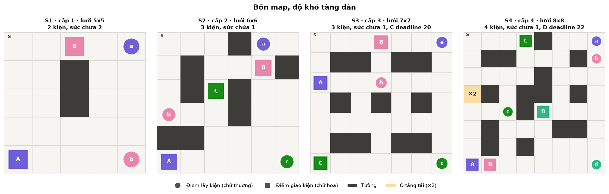
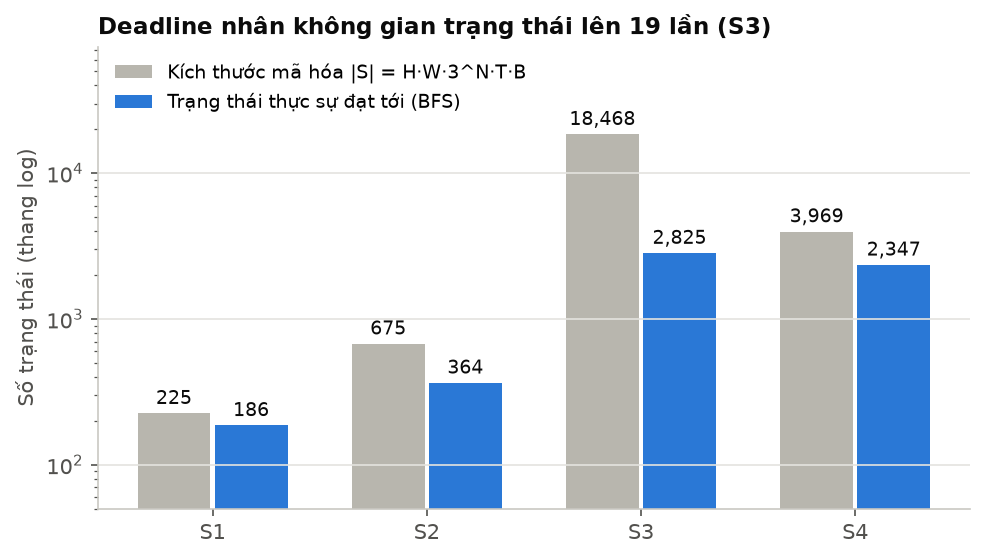
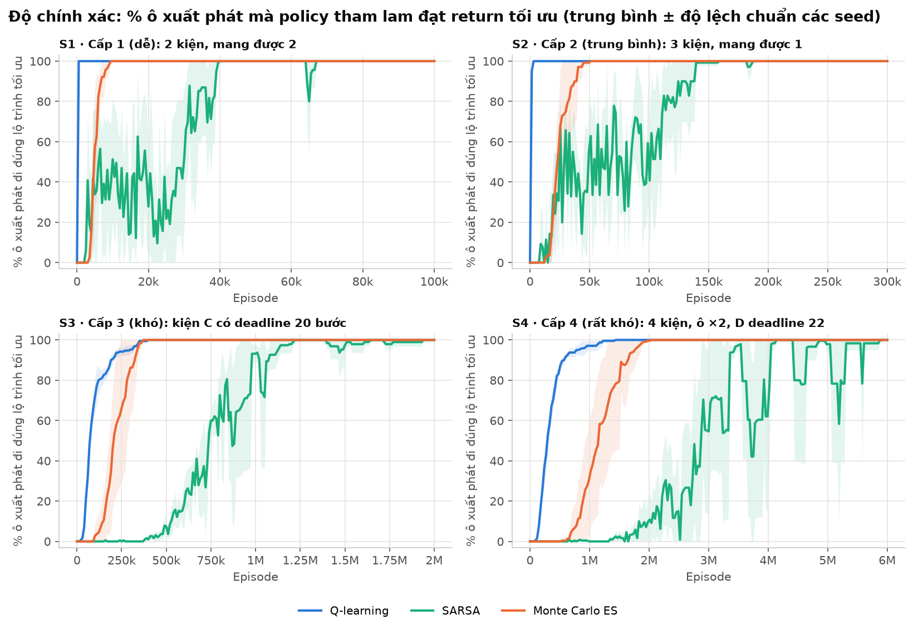
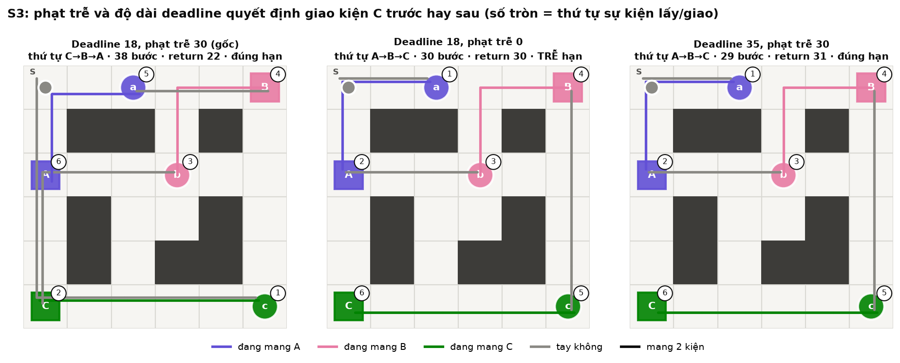
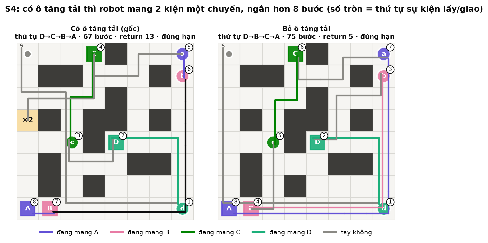
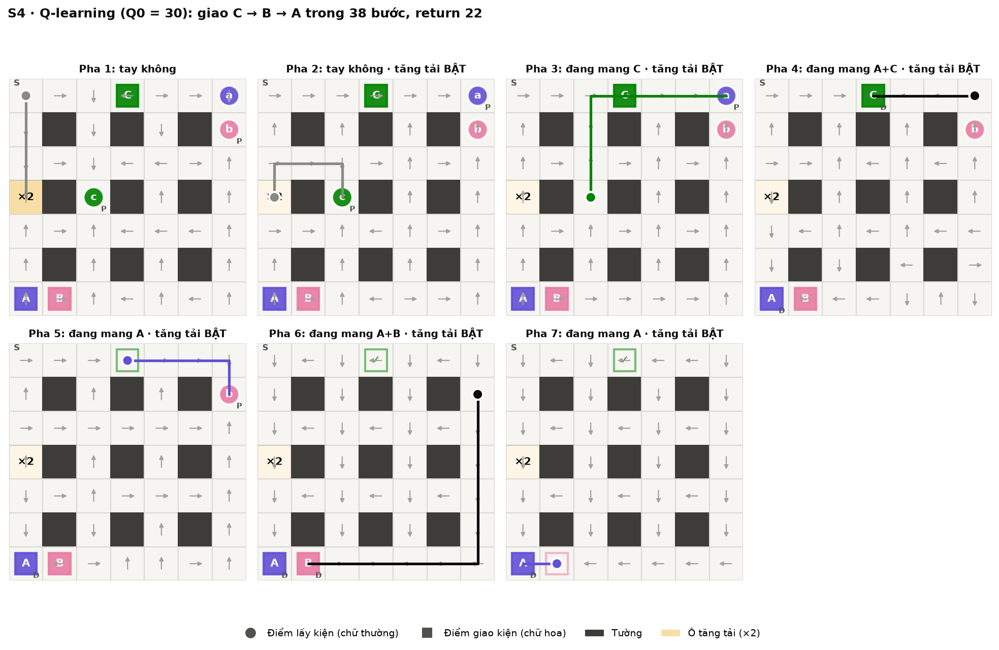
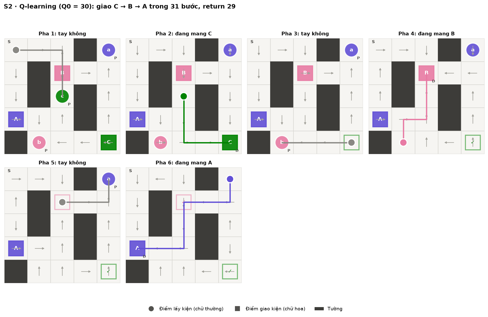
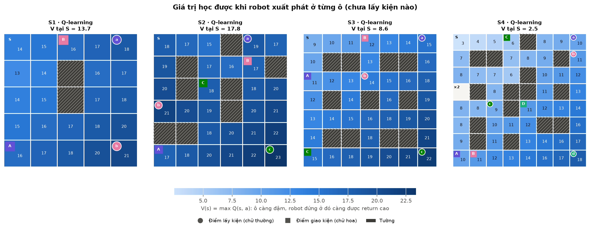
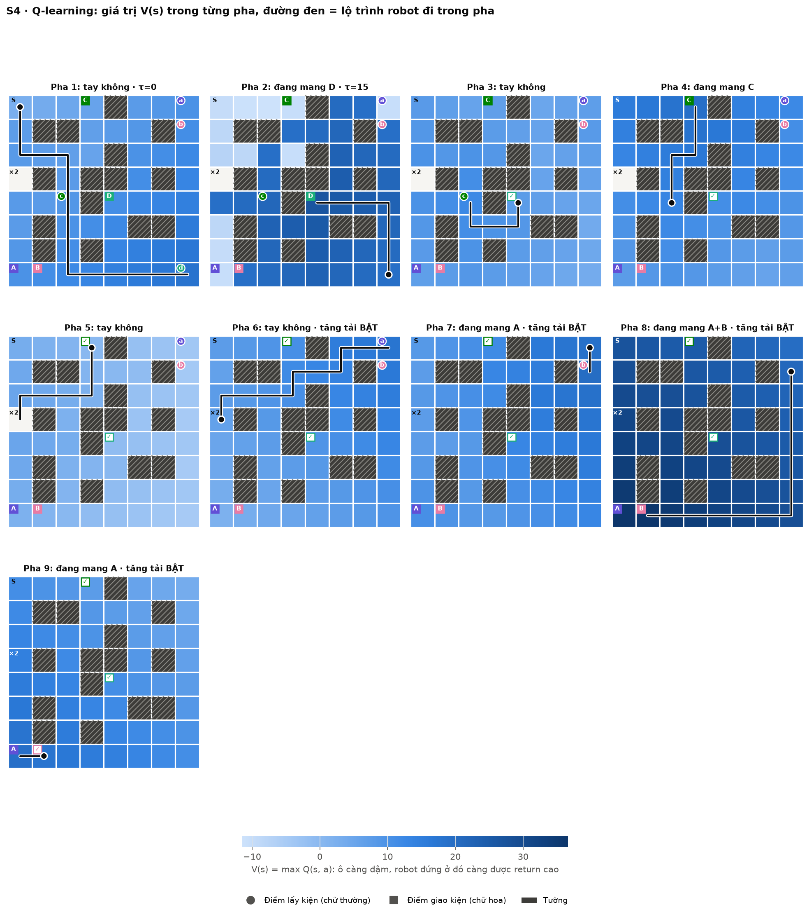

# Đề tài 13 – Multi-Delivery Robot (Q-learning, SARSA & Monte Carlo)

Robot đi trên lưới ô vuông, nhặt nhiều kiện hàng và giao tới đúng đích. Agent **tự quyết định thứ tự** lấy – giao để được nhiều điểm nhất. Môi trường viết bằng `gymnasium` (dựa theo Taxi-v3), agent học bằng **bảng Q** với ba thuật toán: **Q-learning**, **SARSA** và **Monte Carlo ES**. Không dùng DQN hay mạng nơ-ron.

Có **4 map theo cấp độ khó tăng dần**. Mỗi cấp thêm một cơ chế mới: nhiều kiện hơn, sức chứa 1, deadline, ô tăng tải.

Sau khi cải tiến, cả ba thuật toán đều đạt **100% độ chính xác trên cả 4 map, 5/5 seed**. Độ chính xác ở đây là tỉ lệ ô xuất phát mà policy đi đúng lộ trình tối ưu. Vòng lặp huấn luyện được biên dịch bằng `numba`, nhanh hơn bản Python thuần khoảng 150–180 lần, nên chạy được hàng triệu episode trong vài chục giây.

Tài liệu này giải thích **từng file code, từng công thức, luật chơi và các biểu đồ** theo cách đơn giản nhất.

---

## Mục lục

1. [Chạy nhanh (máy tính và Google Colab)](#1-chạy-nhanh-máy-tính-và-google-colab)
2. [Cấu trúc thư mục](#2-cấu-trúc-thư-mục)
3. [Luật chơi và 4 cấp độ](#3-luật-chơi-và-4-cấp-độ)
4. [Mô hình MDP và toán học](#4-mô-hình-mdp-và-toán-học)
5. [Giải thích từng file code](#5-giải-thích-từng-file-code)
6. [Ba thuật toán học và các cải tiến](#6-ba-thuật-toán-học-và-các-cải-tiến)
7. [Thí nghiệm và biểu đồ](#7-thí-nghiệm-và-biểu-đồ)
8. [Kết quả chính](#8-kết-quả-chính)
9. [Câu hỏi hay gặp khi bảo vệ](#9-câu-hỏi-hay-gặp-khi-bảo-vệ)
10. [Bảng ký hiệu: toán ↔ code](#10-bảng-ký-hiệu-toán--code)

---

## 1. Chạy nhanh (máy tính và Google Colab)

### Trên máy tính

```bash
pip install gymnasium numpy matplotlib numba

python experiments.py                # toàn bộ thí nghiệm, 5 seed (khoảng 4 phút với 12 nhân CPU)
python experiments.py --quick        # bản thử nhanh (2 seed, 1/20 số episode, khoảng 20 giây)
python experiments.py --scale 2      # gấp đôi số episode mọi map (học lâu hơn)
python experiments.py --no-baseline  # bỏ phần so sánh với cấu hình cũ (nhanh gấp đôi)
python plots.py                      # vẽ tất cả biểu đồ vào figures/
python plots.py --lang en            # cùng các biểu đồ nhưng nhãn tiếng Anh, lưu vào figures_en/
python convergence.py                # huấn luyện lại có đo hội tụ của Q về Q* (khoảng 1–2 phút), vẽ 2 hình
python convergence.py --plot-only --lang en   # chỉ vẽ lại từ results/convergence.npz, nhãn tiếng Anh
python demo.py                       # xem robot chạy 1 episode bằng policy đã học (map S4)
python demo.py --config configs/s2_three_parcels.json --algo sarsa --gif   # map khác, thuật toán khác, lưu ảnh động
python play.py                       # tự chơi bằng bàn phím: W/A/S/D đi, J nhặt, K giao (map S1)
python play.py --config configs/s4_booster.json   # tự chơi map khác
```

`demo.py` tự huấn luyện nếu chưa có bảng Q trong `results/`, nên có thể chạy ngay mà không cần `experiments.py`. Không cài `numba` thì code vẫn chạy (Python thuần), chỉ chậm hơn rất nhiều.

### Trên Google Colab

Mở `colab_train.ipynb` trên Colab (File → Upload notebook) rồi chạy lần lượt từng ô. Notebook có hai cách lấy code:

- **`drive`** *(khuyên dùng)*: chép cả thư mục `Project_RL` lên Google Drive vào `MyDrive/Project_RL`. Kết quả ghi thẳng vào Drive.
- **`github`**: clone từ `https://github.com/Qwup2112/multi-delivery-robot-rl.git`. Cần push code mới lên trước. Ô cuối nén kết quả để tải về.

Notebook cài `numba`, chạy thử `--quick`, chạy đầy đủ, vẽ hình, đo hội tụ, tạo ảnh động và in bảng độ chính xác. Đổi `SCALE` ở ô huấn luyện để thêm episode.

> **Lưu ý về tốc độ:** học tăng cường dạng bảng chạy trên CPU, GPU không giúp được gì. Colab miễn phí thường có 2 nhân CPU, nên một lượt đầy đủ ước tính mất 30–45 phút. Máy 12 nhân làm cùng việc đó trong khoảng 5 phút. Colab có ích khi muốn máy mình rảnh trong lúc huấn luyện. Phần tăng tốc thật sự đến từ `numba` (mục 5.3).

---

## 2. Cấu trúc thư mục

```
Project_RL/
├── configs/                  # 4 file cấu hình map (JSON), cấp 1 → 4
│   ├── s1_two_parcels.json   #   S1 · cấp 1 (dễ): 2 kiện, mang được 2
│   ├── s2_three_parcels.json #   S2 · cấp 2 (trung bình): 3 kiện, mang được 1
│   ├── s3_deadline.json      #   S3 · cấp 3 (khó): kiện C có deadline
│   └── s4_booster.json       #   S4 · cấp 4 (rất khó): 4 kiện, ô tăng tải + kiện D có deadline
├── delivery_env.py           # MÔI TRƯỜNG: trạng thái, mã hóa, hàm chuyển, reward, bảng chuyển lập sẵn
├── agents.py                 # AGENT: Q-learning, SARSA, Monte Carlo (biên dịch bằng numba), chạy policy tham lam
├── planner.py                # Value Iteration -> return tối ưu (mốc so sánh)
├── experiments.py            # chạy mọi thí nghiệm, lưu vào results/
├── plots.py                  # vẽ biểu đồ vào figures/
├── convergence.py            # đo và vẽ độ hội tụ của bảng Q về Q* (Value Iteration)
├── demo.py                   # demo 1 episode
├── play.py                   # tự chơi bằng bàn phím (W/A/S/D, J, K)
├── colab_train.ipynb         # notebook chạy toàn bộ trên Google Colab
├── Nguyen_Quang_Trungg-22011211/   # báo cáo (tiếng Việt) + slide (tiếng Anh)
├── results/                  # kết quả: summary.json, *.npz (đường học), Q_*.npz (bảng Q), log.txt (log lần chạy đầy đủ)
├── figures/                  # các hình PNG dùng cho báo cáo và slide
└── figures_en/               # cùng các hình, nhãn tiếng Anh (plots.py --lang en)
```

Luồng chạy: `configs/*.json` → `delivery_env.py` tạo môi trường và lập bảng chuyển → `agents.py` học bảng Q → `experiments.py` lưu số liệu → `plots.py` vẽ hình → `demo.py` chạy thử.

---

## 3. Luật chơi và 4 cấp độ

### Bản đồ



| Ký hiệu trong file JSON | Ý nghĩa |
| --- | --- |
| `.` | ô trống |
| `#` | tường (không đi vào được) |
| `S` | ô xuất phát của robot khi đánh giá (depot) |
| `B` | ô tăng tải (chỉ có ở S4; trên hình vẽ là ô vàng "×2") |

Mỗi kiện có **điểm lấy** (hình tròn, chữ thường `a b c d`) và **điểm giao** (hình vuông, chữ hoa `A B C D`).

### Hành động (6 hành động)

| Số | Hành động | Phím (`play.py`) | Tác dụng |
| --- | --- | --- | --- |
| 0 | Lên | W | đi lên 1 ô (đâm tường / ra ngoài thì đứng yên) |
| 1 | Xuống | S | đi xuống 1 ô |
| 2 | Trái | A | sang trái 1 ô |
| 3 | Phải | D | sang phải 1 ô |
| 4 | Pickup | J | nhặt kiện đang chờ ở ô hiện tại (nếu còn chỗ) |
| 5 | Drop | K | giao kiện đang mang nếu ô hiện tại là đích của nó |

### Điểm thưởng (reward)

| Sự kiện | Reward |
| --- | --- |
| Mỗi bước (kể cả đâm tường) | −1 |
| Giao đúng 1 kiện | +20 (reward theo từng đơn) |
| Pickup/Drop sai chỗ hoặc quá sức chứa | −10 (cộng thêm −1 của bước) |
| Kiện deadline chưa giao khi hết hạn (phạt 1 lần) | −30 |

### Kết thúc

- **Thắng (terminated):** mọi kiện đều đã giao.
- **Hết giờ (truncated):** đi quá `max_steps` bước (100 / 150 / 200 / 300 cho S1–S4).

### 4 cấp độ khó tăng dần

Mỗi cấp thêm **một cơ chế mới** so với cấp trước, và lưới cũng lớn dần:

| Cấp | Map | Lưới | Kiện | Sức chứa | Cơ chế mới | Lộ trình tối ưu |
| --- | --- | --- | --- | --- | --- | --- |
| 1 · dễ | S1 | 5x5 | 2 | 2 | mang được cả 2 kiện cùng lúc | A → B, 22 bước, return 18 |
| 2 · trung bình | S2 | 6x6 | 3 | 1 | chỉ mang 1 kiện, phải chọn thứ tự | B → A → C, 36 bước, return 24 |
| 3 · khó | S3 | 7x7 | 3 | 1 | kiện C phải giao trong 20 bước đầu | C → B → A, 44 bước, return 16 |
| 4 · rất khó | S4 | 8x8 | 4 | 1 | ô tăng tải `B` (mang được 2 trong 1 chuyến) **và** kiện D có deadline 22 bước | D → C → B → A, 67 bước, return 13 |

"Lộ trình tối ưu" tính bằng Value Iteration (`planner.py`). Độ khó tăng ở mọi thước đo: số trạng thái đạt tới (186 → 535 → 4 027 → 15 612), độ dài lộ trình tối ưu (22 → 36 → 44 → 67 bước) và số đánh đổi phải học:

- **S3:** nếu không có deadline thì đi B → A → C ngắn hơn (40 bước). Deadline buộc robot giao C trước dù tổng đường dài hơn 4 bước.
- **S4:** robot phải giao D trước để kịp hạn, rồi vòng qua ô ×2 để mang A và B cùng một chuyến. Bỏ ô tăng tải thì lộ trình dài thêm 8 bước (mục 8.5).

---

## 4. Mô hình MDP và toán học

MDP gồm 5 phần: tập trạng thái S, tập hành động A, hàm chuyển, reward và hệ số chiết khấu γ = 0,99.

### 4.1 Trạng thái là gì?

Mỗi trạng thái là một **tuple 5 phần**:

```
s = (hàng, cột, (σ1, σ2, ..., σN), τ, b)
```

| Thành phần | Giá trị | Ý nghĩa |
| --- | --- | --- |
| hàng, cột | 0..H−1, 0..W−1 | vị trí robot |
| σi | 0 / 1 / 2 | kiện i: **chưa lấy / đang mang / đã giao** |
| τ | 0..T_d | đồng hồ deadline (S3, S4); các map khác luôn = 0 |
| b | 0 / 1 / 2 | ô tăng tải: **chưa dùng / đang hiệu lực / đã dùng hết** (chỉ S4) |

**Vì sao cần τ và b? (tính Markov)**
Markov nghĩa là: biết trạng thái hiện tại là đủ để biết tương lai, không cần nhớ quá khứ.

- Không có τ: robot ở cùng ô, cùng trạng thái kiện, nhưng lần này còn 10 bước, lần khác đã quá hạn → tương lai khác nhau → vi phạm Markov. Vì vậy phải đưa τ vào trạng thái.
- Không có b: không biết robot đang được mang 2 kiện hay chỉ 1 → hành động Pickup cho kết quả khác nhau → vi phạm Markov.
- Mẹo gộp trạng thái: khi kiện deadline đã giao, đặt τ = T_d (thời gian không còn ảnh hưởng reward) để không sinh ra trạng thái thừa.

### 4.2 Mã hóa trạng thái thành một số nguyên

Bảng Q là mảng 2 chiều `Q[số_trạng_thái, hành_động]`, nên tuple phải đổi thành **một số nguyên**.

**Bước 1 – trạng thái các kiện là một số cơ số 3:**

```
code = σ1·3⁰ + σ2·3¹ + ... + σN·3^(N−1)        (0 ≤ code < 3^N)
```

**Bước 2 – ghép tất cả (giống đổi giờ-phút-giây ra giây):**

```
idx = (((hàng·W + cột)·3^N + code)·T + τ)·B + b
```

**Bước 3 – giải mã** (`decode`) làm ngược lại bằng `divmod` liên tiếp.

**Ví dụ (S3, W = 7, N = 3, T = 21, B = 1):** robot ở (2, 3), A đã giao (2), B đang mang (1), C chưa lấy (0), τ = 7.

```
code = 2·1 + 1·3 + 0·9 = 5
idx  = ((2·7 + 3)·27 + 5)·21 + 7 = (459 + 5)·21 + 7 = 9751
```

Kiểm tra bằng code: `env.encode((2,3,(2,1,0),7,0))` → `9751`, `env.decode(9751)` → `(2,3,(2,1,0),7,0)`.

### 4.3 Kích thước state space

```
|S| = H · W · 3^N · T · B          T = T_d + 1 nếu có deadline, ngược lại 1
                                   B = 3 nếu có ô tăng tải, ngược lại 1
```

| Map | H·W | 3^N | T | B | \|S\| mã hóa | Trạng thái đạt tới (BFS) | \|A\| |
| --- | --- | --- | --- | --- | --- | --- | --- |
| S1 | 25 | 9 | 1 | 1 | 225 | 186 | 6 |
| S2 | 36 | 27 | 1 | 1 | 972 | 535 | 6 |
| S3 | 49 | 27 | 21 | 1 | 27 783 | 4 027 | 6 |
| S4 | 64 | 81 | 23 | 3 | 357 696 | 15 612 | 6 |



Số trạng thái **đạt tới** nhỏ hơn nhiều vì: không đứng trên tường được; sức chứa 1 nên không có 2 kiện cùng σ = 1; τ, b chỉ nhận giá trị đi tới được (ví dụ τ không thể lớn hơn số bước đã đi). Hàm `reachable_states()` đếm bằng BFS.

### 4.4 Hàm chuyển (transition) – từng bước

Hàm `transition(state, action)` trong `delivery_env.py` làm đúng 4 việc:

1. **Di chuyển:** tính ô mới; nếu ngoài lưới hoặc là tường thì đứng yên. Bước vào ô tăng tải khi b = 0 → b = 1.
2. **Pickup:** sức chứa = 2 nếu b = 1, ngược lại `capacity`. Có kiện σ = 0 tại ô này và số kiện đang mang < sức chứa → σ = 1. Ngược lại phạt −10.
3. **Drop:** có kiện đang mang (σ = 1) mà đích là ô này → σ = 2, cộng reward của đơn. Nếu b = 1 và robot vừa trống tay → b = 2 (hết chuyến tăng tải). Ngược lại phạt −10.
4. **Đồng hồ deadline:** kiện deadline đã giao → τ = T_d; chưa giao → τ tăng 1 (dừng ở T_d), đúng lúc chạm T_d thì phạt −30.

Môi trường **tất định**: cùng (s, a) luôn ra cùng s'. Kết thúc khi mọi σ = 2.

---

## 5. Giải thích từng file code

### 5.1 `configs/*.json` – file cấu hình map

```json
{
  "name": "S3_kien_deadline",
  "level": 3,                                 // cấp độ khó (1..4)
  "grid": ["S......", ".##.##.", ...],        // bản đồ, mỗi chuỗi là 1 hàng
  "capacity": 1,                              // số kiện mang được cùng lúc
  "parcels": [                                // danh sách kiện
    {"name": "C", "pickup": [6, 6], "drop": [6, 0], "reward": 20, "deadline": 20}
  ],
  "rewards": {"step": -1, "illegal": -10, "late_penalty": 30},
  "max_steps": 200,
  "train": {"episodes": 2000000, "gamma": 0.99, "best": "ql"}
}
```

`train.episodes` là số episode huấn luyện của map đó (`--scale` nhân thêm). Tham số của từng thuật toán (α, ε...) dùng chung cho mọi map và nằm trong `ALGOS` của `experiments.py`. `best` là thuật toán dùng cho hình policy và các thí nghiệm đổi reward. Muốn tạo map mới: copy một file, sửa `grid` và `parcels`. Không cần sửa code.

### 5.2 `delivery_env.py` – môi trường

| Hàm / biến | Làm gì |
| --- | --- |
| `UP, DOWN, LEFT, RIGHT, PICKUP, DROP` | số hiệu 6 hành động (0..5) |
| `WAITING, CARRYING, DELIVERED` | 3 trạng thái kiện (0, 1, 2) |
| `__init__(config, start_mode)` | đọc map, tìm tường / ô S / ô B, tính `n_pos`, `n_codes = 3^N`, `n_tau`, `n_boost`, `n_states`; khai báo `observation_space = Discrete(n_states)`, `action_space = Discrete(6)` |
| `encode(state)` | tuple → số nguyên (công thức mục 4.2) |
| `decode(idx)` | số nguyên → tuple |
| `transition(state, action)` | **trái tim của trò chơi** (mục 4.4); trả về `(s', reward, terminated, event)` |
| `reachable_states()` | BFS từ mọi ô xuất phát để tìm trạng thái đạt tới (lưu lại, chỉ tính 1 lần) |
| `tables()` | **lập sẵn hàm chuyển** cho mọi (trạng thái đạt tới, hành động) thành 3 mảng `NS` (trạng thái kế tiếp), `R` (reward), `D` (có giao hết hàng không). Môi trường tất định nên 3 mảng này chứa toàn bộ luật chơi |
| `start_states(mode)` | mảng các trạng thái xuất phát (đã mã hóa) theo `start_mode` |
| `reset()` | đặt robot ở ô xuất phát theo `start_mode` |
| `step(action)` | gọi `transition`, tăng bộ đếm bước, báo `truncated` khi hết `max_steps` |
| `render()` | vẽ map bằng chữ: `@` robot, `a/b/c/d` kiện chờ, `A/B/C/D` đích, `*` đã giao, `+` ô tăng tải (`o` khi đã kích hoạt) |

Ba chế độ xuất phát (`start_mode`):

- `"depot"`: luôn ở ô S. Dùng để **đánh giá** policy.
- `"random_cell"`: ô trống ngẫu nhiên, mọi kiện chưa lấy, τ = 0, b = 0 (giống Taxi). Cấu hình **cũ** dùng chế độ này để huấn luyện. Đánh giá độ chính xác cũng xuất phát từ tất cả các ô này.
- `"exploring"`: một trạng thái **bất kỳ** đạt tới được (kiện đang mang, đã giao, τ, b tùy ý), gọi là exploring starts. Cấu hình **mới** dùng chế độ này để huấn luyện (mục 6.5).

### 5.3 `agents.py` – ba thuật toán (biên dịch bằng numba)

**Vì sao nhanh?** Bản cũ gọi `env.step()` của gymnasium ở mỗi bước. Mỗi lần gọi phải dựng tuple, mã hóa, chạy `transition` bằng Python. Bản mới:

1. Gọi `env.tables()` **một lần** để lập sẵn `NS, R, D`. Một bước đi chỉ còn là `s2 = NS[s, a]; r = R[s, a]; term = D[s, a]`.
2. Vòng lặp huấn luyện viết bằng numpy thuần và gắn `@njit` của **numba**. numba biên dịch hàm Python thành mã máy lúc chạy lần đầu, lưu cache, nên những lần sau chạy ngay.

Kết quả đo trên S2, 20 000 episode, cùng tham số, 1 process: Q-learning 10,7 s → 0,06 s (nhanh hơn khoảng 180 lần), Monte Carlo 15,4 s → 0,10 s (khoảng 160 lần). Một seed trên S4 với 6 triệu episode mất khoảng 23–38 giây.

| Hàm | Làm gì |
| --- | --- |
| `_schedule(ep, n, start, end, decay_frac, exponential)` | giá trị ε (hoặc α) tại episode `ep`: đi từ `start` tới `end` trong `decay_frac·n` episode đầu, giảm tuyến tính hoặc theo cấp số nhân |
| `_eps_greedy(Q, s, eps)` | xác suất ε chọn ngẫu nhiên; còn lại chọn `argmax Q[s]` (hòa thì bốc ngẫu nhiên đều) |
| `_argmax(Q, s)` | hành động có Q lớn nhất (hòa thì lấy chỉ số đầu, giống `np.argmax`) |
| `_td_chunk(...)` | vòng lặp **Q-learning** hoặc **SARSA** cho một đoạn episode (mục 6.1, 6.2) |
| `_mc_chunk(...)` | vòng lặp **Monte Carlo** first-visit cho một đoạn episode (mục 6.3) |
| `_rollouts(...)` | chạy policy tham lam từ nhiều trạng thái xuất phát, trả về return / số bước / có giao hết không |
| `q_learning(...)`, `sarsa(...)`, `monte_carlo(...)` | hàm gọi từ Python: tạo bảng Q, chạy từng đoạn `eval_every` episode, sau mỗi đoạn đánh giá policy tham lam |
| `greedy_returns(env, Q, starts)` | return của policy tham lam từ mỗi trạng thái trong `starts` |
| `optimal_returns(env)` | return tối ưu (Value Iteration) từ mỗi ô xuất phát, làm mốc tính độ chính xác |
| `run_greedy(env, Q)` | chạy 1 episode tham lam qua API gymnasium, trả về quỹ đạo và các sự kiện (dùng cho hình và demo) |
| `save_q`, `load_q` | lưu / đọc bảng Q dạng nén `.npz` |

Ba hàm học đều trả về `(Q, hist)`. `hist` lưu, ở mỗi lần đánh giá: episode, return từ ô S, có giao hết không, **độ chính xác** (`eval_acc`), và trung bình return / độ dài của các episode huấn luyện trong đoạn vừa chạy.

### 5.4 `planner.py` – Value Iteration (mốc tối ưu)

Vì môi trường nhỏ và tất định, ta liệt kê được mọi trạng thái rồi lặp phương trình Bellman tối ưu tới khi hội tụ (dùng luôn bảng `NS, R, D` của `env.tables()`):

```
V(s) ← max_a [ r(s,a) + γ · V(s') ]      (V = 0 ở trạng thái kết thúc)
```

Kết quả cho biết **return tốt nhất có thể** (đường ngang "tối ưu" trên các biểu đồ) và Q* để đo hội tụ. Đây chỉ là thước đo, không phải thuật toán học được so sánh.

### 5.5 `experiments.py` – chạy thí nghiệm

1. Với mỗi map: tính |S|, số trạng thái đạt tới, lộ trình tối ưu.
2. **Phần 1:** mỗi map × 3 thuật toán (`ql`, `sarsa`, `mc`) với cấu hình mới × 5 seed.
3. **Phần 3:** cùng số episode nhưng dùng **cấu hình cũ** (`ql_cu`, `sarsa_cu`, `mc_cu`) để đo mức cải thiện. Phần 1 và 3 chạy chung một `multiprocessing.Pool`, job dài chạy trước.
4. **Phần 2:** đổi reward / tham số môi trường (phạt trễ 0 hay 30, deadline 20 hay 45, có hay không ô tăng tải), dùng Q-learning, mỗi biến thể 5 seed.
5. Lưu `results/summary.json`, `results/<map>.npz` (đường học), `results/Q_<map>_<thuật toán>.npz` (bảng Q của seed 0).

Tham số dòng lệnh: `--quick`, `--scale`, `--seeds`, `--no-baseline`, `--workers` (mục 1).

### 5.6 `plots.py` – vẽ biểu đồ

Đọc `results/` và vẽ 17 hình vào `figures/` (mục 7). Thêm `--lang en` để vẽ cùng các hình với nhãn tiếng Anh vào `figures_en/`. Hàm `L(vi, en)` chọn chuỗi theo ngôn ngữ.

### 5.6b `convergence.py` – đo hội tụ của bảng Q

Huấn luyện lại đúng các lần chạy của `experiments.py` (cùng seed, cùng tham số). Mỗi lần đánh giá, tham số `on_eval` của hàm học gọi một hàm đo 3 chỉ số so với Q* của Value Iteration, trên mọi trạng thái đạt tới chưa giao hết hàng:

- **Sai số trung bình** |Q(s,a) − Q*(s,a)|: bảng Q còn cách bảng tối ưu bao xa.
- **% trạng thái chọn đúng**: tỉ lệ trạng thái mà argmax Q(s,·) là một hành động tối ưu.
- **Q(S,·)**: hàng Q tại ô xuất phát, để xem giá trị từng hành động thay đổi theo thời gian.

Hàm đo không dùng bộ sinh số ngẫu nhiên nên bảng Q cuối cùng trùng khớp với `results/Q_*.npz`. Kết quả lưu vào `results/convergence.npz` và vẽ ra `convergence.png`, `convergence_S2_start.png`.

### 5.7 `demo.py` – demo 1 episode

Đọc bảng Q đã học (hoặc tự huấn luyện thuật toán được chọn bằng `--algo ql|sarsa|mc`), chạy policy tham lam từ ô S, in map dạng chữ sau mỗi bước kèm hành động, reward và sự kiện. Thêm `--gif` để lưu ảnh động.

### 5.7b `play.py` – tự chơi bằng bàn phím

Người chơi điều khiển robot thay cho agent, xuất phát ở ô S: **W/A/S/D** để đi, **J** để nhặt (Pickup), **K** để giao (Drop), **R** để chơi lại, **Q** để thoát. Luật và reward giống hệt lúc agent học, vì `play.py` gọi đúng `env.step()`. Sau mỗi bước, màn hình in lại map dạng chữ cùng reward, tổng điểm và sự kiện (lấy/giao kiện, thao tác sai, đâm tường, trễ deadline). Hết ván thì so với lộ trình tối ưu tính bằng Value Iteration. Ở nơi không đọc được từng phím (Colab, Git Bash), gõ cả chuỗi phím rồi Enter, ví dụ `ddddj`.

### 5.8 `colab_train.ipynb` – chạy trên Google Colab

Notebook gọi lại đúng các script trên: lấy code (Drive hoặc GitHub), `pip install numba`, chạy `experiments.py`, `plots.py`, `convergence.py`, `demo.py`, rồi hiện bảng độ chính xác và vài hình chính (mục 1).

---

## 6. Ba thuật toán học và các cải tiến

Cả ba đều học bảng **Q(s, a)** = "nếu đang ở s, làm a rồi sau đó chơi tốt, thì được tổng bao nhiêu điểm (có chiết khấu)". Học xong, policy là: ở mỗi trạng thái chọn hành động có Q lớn nhất. Chúng chỉ khác nhau ở **mục tiêu** dùng để cập nhật Q.

### 6.1 Q-learning (học sau từng bước, off-policy)

```
Q(s,a) ← Q(s,a) + α · [ r + γ · max_a' Q(s',a') − Q(s,a) ]
                        └──────── mục tiêu ────────┘
```

- `r + γ·max Q(s')`: điểm vừa nhận + giá trị **tốt nhất** ước lượng từ ô kế tiếp (**bootstrap**), bất kể bước sau agent có đi khám phá hay không. Vì thế Q-learning học thẳng Q* (off-policy).
- **α = 1:** môi trường tất định nên mục tiêu không có nhiễu, không cần lấy trung bình; gán thẳng Q(s,a) = mục tiêu là nhanh nhất.
- Nếu bước đó **kết thúc thật** (giao hết hàng) thì mục tiêu chỉ là r. Nếu chỉ **hết giờ** thì vẫn cộng γ·max Q(s').

**Ví dụ số:** Q(s,a) = 0, r = −1, γ = 0,99, max Q(s') = 10
→ mục tiêu = −1 + 0,99·10 = 8,9 → với α = 1: Q mới = **8,9** (với α = 0,5 của cấu hình cũ: 4,45).

### 6.2 SARSA (học sau từng bước, on-policy)

```
Q(s,a) ← Q(s,a) + α · [ r + γ · Q(s',a') − Q(s,a) ]
```

Tên SARSA lấy từ 5 thứ dùng trong một lần cập nhật: **S**, **A**, **R**, **S'**, **A'**. Khác Q-learning đúng một chỗ: thay `max_a' Q(s',a')` bằng `Q(s',a')`, trong đó **a' là hành động agent sẽ làm thật** ở s' (chọn bằng ε-greedy, có thể là bước khám phá ngẫu nhiên). Vì vậy SARSA học giá trị của **chính policy ε-greedy nó đang chạy** (on-policy). Khi ε → 0 thì policy đó tiến về tham lam và Q tiến về Q*.

**Ví dụ số:** như ví dụ 6.1, nhưng ở s' agent bốc trúng một hành động khám phá có Q(s',a') = 2 (trong khi max Q(s') = 10), α = 0,5:
mục tiêu = −1 + 0,99·2 = 0,98 → Q mới = 0 + 0,5·0,98 = **0,49** (Q-learning cho 4,45). SARSA "chịu" cái giá của bước khám phá, nên mục tiêu của nó **nhiễu** theo hành động được bốc ngẫu nhiên.

Hệ quả và cách chỉnh trong code:
- Mục tiêu nhiễu → α không thể bằng 1. α giảm tuyến tính **0,5 → 0,1** để lấy trung bình dần.
- Muốn học đúng Q* thì ε phải tiến về 0 (điều kiện GLIE: khám phá vô hạn lần nhưng tham lam dần). ε giảm theo cấp số nhân **1 → 10⁻⁵** trong nửa đầu, nửa sau gần như tham lam.

### 6.3 Monte Carlo ES (học sau cả episode)

1. **Exploring starts:** bắt đầu episode ở một trạng thái đạt tới ngẫu nhiên, **hành động đầu tiên cũng ngẫu nhiên**.
2. Sau đó đi theo policy **tham lam** (ε = 0) tới khi giao hết hàng hoặc hết `max_steps`, ghi lại (s, a, r) từng bước.
3. Tính return **ngược từ cuối**: `G_t = r_{t+1} + γ·G_{t+1}`.
4. Với mỗi cặp (s, a), chỉ dùng **lần đầu tiên** nó xuất hiện (first-visit): `Q(s,a) ← Q(s,a) + α·(G − Q(s,a))` với **α = 1**, tức Q(s,a) = return mới nhất.

**Ví dụ số:** 3 bước cuối có reward −1, −1, +19 (bước Drop: −1 + 20):
G₂ = 19 → G₁ = −1 + 0,99·19 = 17,81 → G₀ = −1 + 0,99·17,81 = **16,63**.

**Vì sao ε = 0 mà vẫn khám phá được?** Mọi cặp (s, a) đều có cơ hội được chọn làm điểm bắt đầu, nên khám phá đến hoàn toàn từ exploring starts. Đây là thuật toán *Monte Carlo ES* trong sách Sutton & Barto (mục 5.3).

**Vì sao α = 1 hợp lý?** Môi trường tất định và policy tham lam, nên return sau (s, a) là **một con số cố định** với policy hiện tại. Lấy trung bình với return của các policy cũ (kém hơn) chỉ làm Q chậm theo kịp. Nếu policy tham lam lặp vòng, episode bị cắt ở `max_steps`, return rất âm, nên hành động gây lặp tự bị phạt ở lần sau.

### 6.4 So sánh ba thuật toán

| | Q-learning | SARSA | Monte Carlo ES |
| --- | --- | --- | --- |
| Cập nhật khi nào | sau mỗi bước | sau mỗi bước | sau cả episode |
| Mục tiêu | r + γ·max Q(s') | r + γ·Q(s', a') với a' thật sự làm | return thật G |
| Nhiễu của mục tiêu | không có (môi trường tất định) | có (a' bốc ngẫu nhiên khi ε > 0) | không có khi ε = 0 |
| Học giá trị của | policy tối ưu (off-policy) | policy ε-greedy đang chạy (on-policy) | policy tham lam hiện tại (on-policy) |
| Khám phá bằng | ε-greedy + exploring starts | ε-greedy + exploring starts | chỉ exploring starts (ε = 0) |
| α | 1 | 0,5 → 0,1 | 1 |
| ε | 1 → 0,01 (cấp số nhân, 80% đầu) | 1 → 10⁻⁵ (cấp số nhân, 50% đầu) | 0 |
| Cần episode kết thúc? | không | không | có (episode bị cắt thì return lệch) |

### 6.5 Các cải tiến so với cấu hình cũ

Cấu hình cũ: xuất phát ở ô trống ngẫu nhiên, ε giảm **tuyến tính** 1 → 0,05 trong 70% đầu, Q₀ = 0, α = 0,5, Monte Carlo lấy trung bình 1/N. Với cấu hình đó, SARSA và Monte Carlo gần như không học được S3, S4 (mục 8.2). Các thay đổi:

| Cải tiến | Cũ | Mới | Vì sao |
| --- | --- | --- | --- |
| **Exploring starts đầy đủ** | ô trống ngẫu nhiên, mọi kiện chờ, τ = 0, b = 0 | trạng thái đạt tới **bất kỳ** + hành động đầu ngẫu nhiên | Ở S3, S4 chiều τ và b nhân số trạng thái lên nhiều lần. Những trạng thái như "đang mang C, τ = 15" chỉ gặp khi robot tự đi tới, nên ít được cập nhật. Exploring starts cho **mọi** cặp (s, a) được cập nhật trực tiếp. |
| **Lịch ε riêng cho từng thuật toán** | tuyến tính 1 → 0,05 | cấp số nhân; QL → 0,01, SARSA → 10⁻⁵, MC = 0 | ε = 0,05 ở cuối vẫn làm SARSA học giá trị của policy "5% đi bừa" (sai lệch so với Q*) và làm return của MC nhiễu. |
| **Bước học α** | 0,5 (TD), 1/N (MC) | QL 1, SARSA 0,5 → 0,1, MC 1 | Mục 6.1–6.3. Trung bình 1/N của MC "nhớ" mãi các return rất âm của giai đoạn đầu. |
| **Nhiều episode hơn** | 20k / 40k / 100k / 100k (map cũ) | 100k / 300k / 2M / 6M | Map khó hơn và SARSA cần ε → 0 chậm (mục 8.3). Chạy được nhờ numba. |
| **Tăng tốc bằng numba + bảng chuyển lập sẵn** | `env.step()` bằng Python | `NS, R, D` + `@njit` | nhanh hơn khoảng 150–180 lần mỗi episode (mục 5.3). |
| **Thước đo độ chính xác chặt hơn** | chỉ chạy policy từ ô S | thêm % **mọi ô xuất phát** đạt return tối ưu | Từ ô S đúng chưa chắc đã học đúng: Q-learning cấu hình cũ đi tối ưu từ S ở 5/5 seed trên S3, nhưng chỉ đúng ở 20% số ô xuất phát. |

Khởi tạo lạc quan (Q₀ = 30) của bản trước không còn cần: exploring starts đã đảm bảo khám phá, nên mọi thuật toán dùng Q₀ = 0. Tham số được chọn bằng cách dò trên chính 4 map (5 seed mỗi cấu hình) trước khi chạy thí nghiệm cuối.

---

## 7. Thí nghiệm và biểu đồ

Huấn luyện: γ = 0,99; số episode S1: 100 000 · S2: 300 000 · S3: 2 000 000 · S4: 6 000 000 (cả 3 thuật toán như nhau, cấu hình cũ cũng vậy). Mỗi lần huấn luyện đánh giá 200 lần. Mỗi lần đánh giá chạy **policy tham lam** từ ô S (return, giao đủ hay không) và từ **mọi ô xuất phát** (độ chính xác). Mỗi thuật toán chạy 5 seed.

**Độ chính xác** = % ô xuất phát (mọi ô trống, mọi kiện chờ) mà policy tham lam đạt đúng return tối ưu của Value Iteration từ ô đó.

| Hình | Cho thấy |
| --- | --- |
| `figures/maps.png` | 4 map theo cấp độ, vị trí lấy / giao, tường, ô tăng tải |
| `figures/state_space.png` | \|S\| mã hóa và số trạng thái đạt tới (thang log) |
| `figures/accuracy.png` | **độ chính xác theo episode**, trung bình ± độ lệch chuẩn 5 seed |
| `figures/ablation.png` | **độ chính xác cuối: cấu hình cũ và mới**, cùng số episode |
| `figures/learning_curves.png` | đường học: return từ ô S theo episode |
| `figures/success_rate.png` | tỉ lệ seed giao đủ hàng theo episode |
| `figures/episode_length.png` | số bước mỗi episode khi huấn luyện |
| `figures/final_returns.png` | return cuối của từng seed so với tối ưu |
| `figures/convergence.png` | sai số \|Q − Q*\| và % trạng thái chọn đúng theo episode |
| `figures/convergence_S2_start.png` | Q(S, ·) tại ô xuất phát của S2 theo episode, so với Q* |
| `figures/policy_S2.png`, `policy_S3.png`, `policy_S4.png` | policy cuối: mũi tên = hành động tham lam ở mỗi ô, từng "pha" (đang mang kiện nào), đường màu = đường đi thật |
| `figures/value_start.png` | **heatmap giá trị** V(s) = max Q(s, a) khi robot xuất phát ở từng ô (chưa lấy kiện nào); ô càng đậm, xuất phát ở đó càng được return cao |
| `figures/value_S2.png`, `value_S3.png`, `value_S4.png` | heatmap V(s) theo từng pha của lộ trình (chia pha như hình policy), đường đen = đường đi thật |
| `figures/reward_deadline.png` | S3 khi đổi phạt trễ và độ dài deadline |
| `figures/env_booster.png` | S4 có và không có ô tăng tải |
| `figures/demo_S4.gif` | ảnh động robot chạy policy học được trên S4 |

**Cách đọc hình policy:** mỗi ô nhỏ là một "pha" (ví dụ "đang mang C · tăng tải BẬT"). Mũi tên xám là hành động policy chọn nếu robot đứng ở ô đó trong pha này; chữ `P`/`D` là Pickup/Drop. Đường màu là đường robot thực sự đi: màu theo kiện đang mang, xám là tay không, đen là mang 2 kiện.

---

## 8. Kết quả chính




### 8.1 Bảng tổng hợp (policy tham lam cuối cùng, 5 seed)

| Map (tối ưu) | Thuật toán | Return từ S (5 seed) | Độ chính xác | Episode đầu tiên đạt 100% |
| --- | --- | --- | --- | --- |
| S1 (18) | Q-learning | 18 (cả 5) | 100% | 500 |
| | SARSA | 18 (cả 5) | 100% | 5 500 – 33 500 |
| | Monte Carlo ES | 18 (cả 5) | 100% | 7 000 – 9 500 |
| S2 (24) | Q-learning | 24 (cả 5) | 100% | 1 500 – 3 000 |
| | SARSA | 24 (cả 5) | 100% | 64 500 – 159 000 |
| | Monte Carlo ES | 24 (cả 5) | 100% | 30 000 – 51 000 |
| S3 (16) | Q-learning | 16 (cả 5), đúng hạn | 100% | 340 000 – 400 000 |
| | SARSA | 16 (cả 5), đúng hạn | 100% | 980 000 – 1 220 000 |
| | Monte Carlo ES | 16 (cả 5), đúng hạn | 100% | 260 000 – 370 000 |
| S4 (13) | Q-learning | 13 (cả 5), đúng hạn | 100% | 840 000 – 1 440 000 |
| | SARSA | 13 (cả 5), đúng hạn | 100% | 3 450 000 – 4 140 000 |
| | Monte Carlo ES | 13 (cả 5), đúng hạn | 100% | 1 470 000 – 2 040 000 |

60/60 lần chạy (3 thuật toán × 4 map × 5 seed) đều đạt 100%. Bảng Q cũng hội tụ về Q*: sai số trung bình |Q − Q*| cuối cùng là 0 với Q-learning và Monte Carlo ES, 0,01 (S3) và 0,05 (S4) với SARSA (`convergence.png`). Thời gian mỗi seed trên S4: Q-learning 38 s, SARSA 23 s, Monte Carlo ES 38 s. Toàn bộ `experiments.py` mất 221 s trên máy 12 nhân.

### 8.2 Trước và sau cải tiến (cùng số episode)

| Map | Q-learning cũ → mới | SARSA cũ → mới | Monte Carlo cũ → mới |
| --- | --- | --- | --- |
| S1 | 100% → 100% | 55,7% → 100% | 97,4% → 100% |
| S2 | 97,1% → 100% | 52,1% → 100% | 70,7% → 100% |
| S3 | 20,0% → 100% | 1,1% → 100% | 0% → 100% |
| S4 | 61,3% → 100% | 0,4% → 100% | 0% → 100% |

Với cấu hình cũ, trên S3 và S4 SARSA và Monte Carlo đều giao trễ hạn (return −18 đến −30 ở S3) hoặc không giao hết hàng trước khi hết `max_steps` (return −290 đến −330 ở 3/5 seed SARSA và 4/5 seed Monte Carlo trên S4). Q-learning cũ đi đúng lộ trình từ ô S ở cả 5 seed, nhưng từ các ô xuất phát khác thì thường sai: chỉ 20% (S3) và 61% (S4) số ô đúng.

### 8.3 Ảnh hưởng của số episode

Số đo từ lúc dò tham số (cùng map, cùng cấu hình mới, 5 seed). ε giảm theo tỉ lệ số episode, nên chạy ít episode nghĩa là ε cũng giảm nhanh hơn:

| Map | Thuật toán | Ít episode | Nhiều episode |
| --- | --- | --- | --- |
| S3 | Q-learning | 200 000: 98,9% | 2 000 000: 100% |
| S3 | Monte Carlo ES | 200 000: 46,3% | 1 000 000: 100% |
| S3 | SARSA | 1 000 000: 99,5% | 2 000 000: 100% |
| S4 | Q-learning | 500 000: 83,8% | 2 000 000: 100% |
| S4 | Monte Carlo ES | 500 000: 0%; 2 000 000: 99,6% | 5 000 000: 100% |
| S4 | SARSA | 2 000 000: 41,2% | 5 000 000: 99,6%; 6 000 000: 100% |

Muốn học lâu hơn nữa: `python experiments.py --scale 2` (hoặc `SCALE = 2` trong notebook Colab).

### 8.4 Nhận xét

1. **Cả ba thuật toán đều học được lời giải tối ưu ở cả 4 cấp độ**, kể cả ưu tiên kiện deadline (S3, S4) và tận dụng ô tăng tải (S4).
2. **Tốc độ học: Q-learning > Monte Carlo ES > SARSA.** Trên S4, Q-learning đạt 100% sau khoảng 0,8–1,4 triệu episode, Monte Carlo ES 1,5–2,0 triệu, SARSA 3,5–4,1 triệu.
   - Q-learning học Q* từ mọi kinh nghiệm, kể cả bước đi khám phá (off-policy), và mục tiêu không nhiễu.
   - SARSA học giá trị của policy đang khám phá, nên chỉ đúng Q* khi ε đã rất nhỏ. Đó là lý do ε của SARSA giảm tới 10⁻⁵ và nó cần nhiều episode nhất.
   - Monte Carlo ES phải chờ hết episode mới cập nhật, nên lúc đầu chậm hơn Q-learning. Nhưng nhờ policy tham lam và môi trường tất định, return không nhiễu nên nó hội tụ chính xác.
3. **Exploring starts là cải tiến quan trọng nhất**, đặc biệt ở map có deadline: chiều τ tạo ra rất nhiều trạng thái mà robot xuất phát từ τ = 0 hiếm khi đi tới.
4. **Đo từ một ô S chưa đủ.** Q-learning cấu hình cũ "đúng" từ ô S nhưng sai ở phần lớn ô khác. Thước đo trên mọi ô xuất phát cho thấy policy đã thực sự học được bài toán hay chỉ nhớ một đường.

### 8.5 Thí nghiệm đổi reward / tham số môi trường



| Biến thể (Q-learning, 5 seed) | Tối ưu (Value Iteration) | Agent học được |
| --- | --- | --- |
| S3 gốc: deadline 20, phạt trễ 30 | C → B → A, 44 bước, return 16 | giống tối ưu, đúng hạn (5/5) |
| S3: deadline 20, **phạt trễ 0** | B → A → C, 40 bước, return 20 (trễ) | giống tối ưu (5/5) |
| S3: **deadline 45**, phạt trễ 30 | B → A → C, 40 bước, return 20 (đúng hạn) | giống tối ưu (5/5) |
| S4 gốc: có ô tăng tải | D → C → B → A, 67 bước, return 13 | giống tối ưu (5/5) |
| S4: **bỏ ô tăng tải** | D → B → C → A, 75 bước, return 5 | giống tối ưu (5/5) |

- **Phạt trễ 30 → 0 (cấu hình reward):** policy đổi thứ tự. Khi trễ hạn không bị phạt, đi B → A → C ngắn hơn 4 bước nên agent bỏ ưu tiên kiện C.
- **Deadline 20 → 45 (tham số môi trường):** giao C cuối vẫn kịp hạn, nên agent cũng chuyển sang B → A → C. Số trạng thái đạt tới tăng từ 4 027 lên 14 558 nhưng Q-learning vẫn đúng 5/5.
- **Bỏ ô tăng tải (tham số môi trường):** lộ trình dài thêm 8 bước (75 so với 67). Khi có ô tăng tải, robot giao D trước để kịp hạn, lấy rồi giao C, đi qua ô `×2`, lấy A và B (mang 2 kiện) rồi giao cả hai ở góc dưới.



### 8.6 Policy cuối cùng





### 8.7 Bản đồ giá trị (heatmap)

Mỗi ô được tô theo V(s) = max Q(s, a) của bảng Q học được: xanh nhạt = giá trị thấp, xanh đậm = giá trị cao. Ô gạch chéo là tường. Ô xám nhạt là trạng thái không thể xảy ra, ví dụ đứng trên ô ×2 khi tăng tải chưa kích hoạt.



- V tại ô S là 13,7 / 17,8 / 8,6 / 2,5 cho S1–S4. Các số này nhỏ hơn return tối ưu (18 / 24 / 16 / 13) vì V tính có chiết khấu γ = 0,99: phần thưởng +20 nhận càng muộn thì càng bị giảm.
- Trong mỗi pha, ô càng gần mục tiêu hiện tại (kiện cần lấy hoặc đích cần giao) càng đậm. Policy tham lam vì vậy đi về phía ô đậm hơn.



- Deadline hiện rõ trên heatmap. Ở S4 pha 2 (đang mang D, τ = 15) và S3 pha 2 (đang mang C, τ = 13), các ô xa đích có giá trị âm (thấp nhất khoảng −11 ở S4 và −12 ở S3) vì từ đó không kịp giao, chắc chắn bị phạt −30. Các ô gần đích thì đậm. Pha còn deadline được vẽ tại τ của đầu pha.
- Ở S4 pha 8 (mang A + B nhờ ô ×2), gần như cả map đều đậm vì robot sắp nhận hai lần +20 liên tiếp.

---

## 9. Câu hỏi hay gặp khi bảo vệ

**SARSA khác Q-learning ở đâu?**
Chỉ ở mục tiêu: Q-learning dùng `max_a' Q(s',a')` (hành động tốt nhất), SARSA dùng `Q(s',a')` của hành động thật sự sẽ làm. Q-learning học policy tối ưu dù đang khám phá (off-policy). SARSA học giá trị của chính policy ε-greedy (on-policy), nên chỉ trùng Q* khi ε → 0.

**Exploring starts có phải "gian lận" không?**
Không. Nó chỉ đổi **phân phối trạng thái bắt đầu khi huấn luyện** trong bộ mô phỏng, giống Taxi-v3 cho robot xuất phát ở ô ngẫu nhiên. Luật chơi, reward và cách đánh giá (xuất phát với mọi kiện đang chờ) không đổi.

**Monte Carlo ES dùng ε = 0 thì khám phá bằng cách nào?**
Bằng exploring starts: mỗi episode bắt đầu ở một cặp (trạng thái, hành động) ngẫu nhiên, nên mọi cặp đều có cơ hội được thử.

**Vì sao Q-learning và Monte Carlo dùng α = 1?**
Môi trường tất định: mục tiêu của Q-learning và return của Monte Carlo với policy tham lam là các con số cố định, không có nhiễu cần lấy trung bình. SARSA có nhiễu (a' bốc ngẫu nhiên) nên α giảm dần 0,5 → 0,1.

**Độ chính xác được đo thế nào?**
Từ **mọi** ô trống (mọi kiện đang chờ), chạy policy tham lam và so return với return tối ưu của Value Iteration từ cùng ô đó. Độ chính xác là % ô đạt đúng tối ưu.

**Vì sao trạng thái đạt tới ít hơn |S| mà bảng Q vẫn cấp phát đủ |S|?**
Cho đơn giản: chỉ số = công thức `encode`, không cần bảng tra. Bảng lớn nhất (S4) là 357 696 × 6 số thực (khoảng 17 MB trong RAM). Khi lưu thì nén `.npz`, vì hàng của trạng thái không đạt tới đều bằng 0.

**numba là gì, có làm thay đổi thuật toán không?**
numba biên dịch hàm Python thành mã máy. Thuật toán giữ nguyên từng dòng, chỉ chạy nhanh hơn. Không có numba thì cùng code đó chạy bằng Python thuần.

**Chạy trên Colab có nhanh hơn không?**
Thường là không. Colab miễn phí có 2 nhân CPU, còn GPU không giúp được thuật toán dạng bảng. Colab có ích để máy mình rảnh trong lúc huấn luyện.

**Vì sao tăng số episode?**
Với ít episode, SARSA và Monte Carlo ES chưa đạt 100% ở S3, S4 (mục 8.3). ε giảm theo tỉ lệ số episode, nên nhiều episode hơn cũng có nghĩa là khám phá lâu hơn.

**Truncation khác terminal thế nào?**
Terminal = giao hết hàng, tương lai bằng 0. Truncation = hết `max_steps`, trò chơi chưa thật sự kết thúc, nên Q-learning và SARSA vẫn cộng γ·Q(s').

---

## 10. Bảng ký hiệu: toán ↔ code

Cột "Toán" là ký hiệu trong báo cáo, cột "Code" là tên biến trong file Python. Ô "—" nghĩa là chỉ có trong code.

> **Dễ nhầm:** trong `delivery_env.py`, `r, c` là **hàng, cột** của robot; trong `agents.py`, `r` là **reward**. Trong `agents.py`, `s` là trạng thái **đã mã hóa thành số**; trong `delivery_env.py`, `state` / `st` là **tuple**.

### 10.1 Bản đồ và cấu hình (`configs/*.json`, `delivery_env.py`)

| Toán | Code | Ý nghĩa | Ví dụ |
|---|---|---|---|
| H, W | `env.H`, `env.W` | số hàng, số cột của lưới | S3: 7, 7 |
| — | `"S"`, `"#"`, `"B"`, `"."` trong `grid` | ô xuất phát, tường, ô tăng tải ×2, ô trống | |
| — | `env.depot` | tọa độ ô S | (0, 0) |
| — | `env.walls` | tập tọa độ các ô tường | |
| — | `env.booster` | tọa độ ô ×2 (`None` nếu map không có) | S4: (3, 0) |
| — | `env.free_cells` | ô dùng làm điểm xuất phát `random_cell` và để đo độ chính xác (bỏ tường và ô ×2) | |
| N | `env.N` | số kiện | 2, 3 hoặc 4 |
| — | `env.parcels[i]` | kiện i: `name`, `pickup` (ô lấy), `drop` (ô giao), `reward`, `deadline` | |
| capacity | `env.capacity` | số kiện mang cùng lúc tối đa | 1 hoặc 2 |
| — | `env.boost_capacity` | sức chứa khi ô ×2 đang hiệu lực | 2 |
| T_d | `env.deadline` | hạn giao kiện có deadline (số bước) | S3: 20, S4: 22 |
| — | `env.dl_idx` | vị trí của kiện có deadline trong `parcels` (`None` nếu không có) | S3: 2 (kiện C), S4: 3 (kiện D) |
| max_steps | `env.max_steps` | số bước tối đa của một episode | 100 / 150 / 200 / 300 |
| — | `"level"` | cấp độ khó của map | 1..4 |

### 10.2 Phần thưởng

| Toán | Code | Ý nghĩa | Giá trị |
|---|---|---|---|
| r | `reward` (env), `r` (agents) | reward của một bước | |
| — | `env.r_step` | mỗi bước, kể cả đâm tường | −1 |
| — | `env.r_illegal` | cộng thêm khi Pickup/Drop sai | −10 |
| — | `parcels[i]["reward"]` | giao đúng một kiện | +20 |
| — | `env.r_late` | bị trừ một lần khi kiện deadline trễ hạn | 30 |
| 𝟙_del, 𝟙_ill, 𝟙_late | (các nhánh `if` trong `transition`) | bằng 1 nếu bước này giao hàng / làm sai / vừa trễ hạn | |

### 10.3 Trạng thái

| Toán | Code | Ý nghĩa | Ví dụ |
|---|---|---|---|
| s = (row, col, σ₁…σ_N, τ, b) | `state = (r, c, status, tau, boost)` | trạng thái dạng tuple | (2, 3, (2, 1, 0), 7, 0) |
| σᵢ | `status[i]` | trạng thái kiện i: `WAITING` = 0 chưa lấy, `CARRYING` = 1 đang mang, `DELIVERED` = 2 đã giao | |
| τ | `tau` | đồng hồ deadline, đếm số bước, dừng ở T_d | 0…20 |
| b | `boost` | ô ×2: 0 chưa dùng, 1 đang hiệu lực, 2 đã dùng hết | |
| code = Σ σᵢ·3^(i−1) | `code` | trạng thái N kiện đọc như một số cơ số 3 | (2, 1, 0) → 5 |
| idx | kết quả `encode(state)`; `s` trong `agents.py` | số thứ tự trạng thái = số hàng trong bảng Q | 9751 |
| H·W | `env.n_pos` | số ô của lưới | |
| 3^N | `env.n_codes` | số tổ hợp trạng thái kiện | 27 |
| T | `env.n_tau` | số giá trị τ có thể nhận (T_d + 1, hoặc 1) | 21 |
| B | `env.n_boost` | số giá trị b có thể nhận (3, hoặc 1) | 3 |
| \|S\| = H·W·3^N·T·B | `env.n_states` | số trạng thái mã hóa | S3: 27 783 |
| — | `encode(state)` / `decode(idx)` | tuple → số / số → tuple (dùng `divmod`) | |
| — | `reachable_states()` | tập trạng thái thực sự đạt tới được (duyệt BFS) | S3: 4 027 |
| — | `start_states(mode)` | mảng trạng thái xuất phát (đã mã hóa) của `depot` / `random_cell` / `exploring` | |

### 10.4 Hành động và một bước đi

| Toán | Code | Ý nghĩa |
|---|---|---|
| a | `a`, `action` | hành động, số 0…5 |
| — | `UP, DOWN, LEFT, RIGHT, PICKUP, DROP = range(6)` | tên của 6 hành động |
| — | `MOVES` | hành động di chuyển → (dr, dc), ví dụ `UP: (-1, 0)` = lên một hàng |
| \|A\| | `env.action_space.n` | số hành động = 6 |
| s′ | `s2` (agents), `ns` (env) | trạng thái kế tiếp |
| — | `NS[s, a]`, `R[s, a]`, `D[s, a]` | bảng chuyển lập sẵn (`env.tables()`): trạng thái kế tiếp, reward, có giao hết hàng không |
| — | `term` / `terminated` | **kết thúc thật**: đã giao hết hàng |
| — | `trunc` / `truncated` | **bị cắt**: hết `max_steps`, chưa giao xong |
| — | `event`, `info["event"]` | chuỗi sự kiện, ví dụ `lay kien A`, `giao kien A`, `pickup sai` |
| t | `t` (agents), `env.t` | số bước đã đi trong episode hiện tại |

### 10.5 Ba thuật toán học (`agents.py`, `experiments.py`)

| Toán | Code | Ý nghĩa | Giá trị |
|---|---|---|---|
| Q(s, a) | `Q[s, a]` | bảng Q, mảng numpy kích thước `n_states × 6` | |
| Q₀ | `q_init` | giá trị khởi tạo mọi ô của bảng Q | 0 |
| α | `alpha` | bước học (lúc đầu) | QL 1, SARSA 0.5, MC 1 |
| α_end | `alpha_end` | α lúc cuối (giảm tuyến tính); `None` = giữ nguyên | SARSA 0.1 |
| γ | `gamma` | hệ số chiết khấu | 0.99 |
| ε | `eps` | xác suất chọn hành động ngẫu nhiên | |
| ε_s, ε_e | `eps_start`, `eps_end` | ε lúc đầu và lúc cuối | QL 1 → 0.01, SARSA 1 → 1e-5, MC 0 |
| — | `decay_frac` | ε giảm hết trong `decay_frac` phần số episode đầu | QL 0.8, SARSA 0.5 |
| — | `eps_decay` | `"linear"` (tuyến tính) hoặc `"exp"` (cấp số nhân) | `"exp"` |
| — | `start_mode` | trạng thái bắt đầu khi huấn luyện | `"exploring"` |
| — | `random_first` | hành động đầu tiên của episode chọn ngẫu nhiên (exploring starts cho cả (s, a)) | `True` |
| ep, n_ep | `ep`, `n_episodes` | số thứ tự episode, tổng số episode | |
| y | `target` | mục tiêu: `r` nếu kết thúc thật; QL `r + γ·max Q(s′)`; SARSA `r + γ·Q(s′, a′)` | |
| a′ | `a2` | hành động SARSA chọn ở s′ (và sẽ làm thật ở bước sau) | |
| argmax_a Q(s, a) | `_argmax(Q, s)`, `np.argmax(Q[s])` | hành động tham lam (giá trị lớn nhất) | |
| G_t | `G` | return, tính ngược từ cuối episode: `G = gamma * G + r` | |
| N(s, a) | `N[s, a]` | số lần đã cập nhật cặp (s, a) trong Monte Carlo (dùng khi α = 1/N) | |
| — | `buf_s, buf_a, buf_r` | toàn bộ episode Monte Carlo vừa chơi (trạng thái, hành động, reward) | |
| — | `stamp`, `buf_first` | đánh dấu lần **đầu tiên** mỗi cặp (s, a) xuất hiện trong episode | |
| — | `first_visit` | `True` = first-visit, `False` = every-visit | `True` |
| — | `boot_trunc` | MC: episode bị cắt thì lấy max Q(s_T) làm phần return còn lại (tùy chọn, không dùng) | `False` |
| — | `eval_every` | cứ bao nhiêu episode thì đánh giá policy một lần (= n_episodes / 200) | |
| — | `hist` | lịch sử: `eval_ep`, `eval_return`, `eval_success`, `eval_acc`, `train_return`, `train_len` | |
| — | `on_eval` | hàm tùy chọn, được gọi mỗi lần đánh giá (dùng trong `convergence.py`) | |
| — | `ql`, `sarsa`, `mc` | 3 thuật toán với cấu hình mới (`ALGOS`) | |
| — | `ql_cu`, `sarsa_cu`, `mc_cu` | cùng 3 thuật toán với cấu hình cũ (`BASELINE`) | |

### 10.6 Value Iteration (`planner.py`)

| Toán | Code | Ý nghĩa |
|---|---|---|
| V*(s) | `V` | giá trị tốt nhất của trạng thái s |
| Q*(s, a) | `Q` (trả về), `Qs` (`convergence.py`) | giá trị tối ưu của từng hành động |
| — | `S` | các trạng thái đạt tới chưa giao hết (đã mã hóa) |
| — | `NS`, `R`, `D` | hàng tương ứng của bảng chuyển `env.tables()` |
| — | `Qsa` | r + γ·V(s′) cho mọi (s, a) trong một vòng lặp |
| θ | `theta = 1e-8` | ngưỡng dừng |
| Δ | `delta` | thay đổi lớn nhất của V trong một vòng; dừng khi Δ < θ |

### 10.7 Đánh giá và hội tụ

| Toán | Code | Ý nghĩa |
|---|---|---|
| Return | `res["return"]`, `eval_return` | tổng reward (không chiết khấu) của một lần chạy policy tham lam từ ô S |
| — | `success`, `steps` | có giao hết hàng không, số bước đã đi |
| Độ chính xác | `eval_acc`, `accuracy`, `accuracy_mean` | % ô xuất phát mà policy tham lam đạt return tối ưu |
| — | `success_rate`, `optimal_rate` | tỉ lệ seed giao hết / đạt return tối ưu từ ô S (`summary.json`) |
| — | `first_optimal_episode`, `first_full_accuracy_episode` | episode đầu tiên đạt tối ưu từ ô S / đạt độ chính xác 100% |
| \|Q − Q*\| | `q_err` | sai số trung bình của bảng Q so với Q* |
| — | `opt` | mặt nạ: hành động nào là tối ưu ở mỗi trạng thái |
| — | `pol_acc` | % trạng thái đạt tới mà hành động tham lam là tối ưu |
| — | `route`, `pol_route` | các trạng thái trên lộ trình tối ưu từ mọi ô xuất phát / % chọn đúng trên đó |
| Q(S, ·) | `q_start` | hàng Q tại ô xuất phát S |

### 10.8 Ký hiệu trên hình và trong demo

| Ở đâu | Ký hiệu | Ý nghĩa |
|---|---|---|
| hình map / policy | hình tròn chữ thường (a, b, c, d) | điểm lấy kiện |
| | hình vuông chữ hoa (A, B, C, D) | điểm giao kiện |
| | ô tối | tường |
| | ô vàng ×2 | ô tăng tải |
| | mũi tên xám | hành động tham lam ở ô đó; P / D = Pickup / Drop |
| | đường màu | đường robot đi: màu của kiện đang mang, xám = tay không, đen = mang 2 kiện |
| đường học / hội tụ | xanh dương / xanh ngọc / cam | Q-learning / SARSA / Monte Carlo ES |
| | đường ngang | giá trị tối ưu (Value Iteration) |
| | vùng mờ quanh đường | trung bình ± độ lệch chuẩn qua 5 seed |
| `ablation.png` | cột xám / cột màu | cấu hình cũ / cấu hình mới |
| `value_*.png` (heatmap) | xanh nhạt → xanh đậm | V(s) = max Q(s, a) thấp → cao |
| | ô gạch chéo / ô xám nhạt | tường / trạng thái không thể xảy ra |
| | đường đen | đường robot đi trong pha đó |
| `demo.py`, `play.py` (map chữ) | `@` | robot |
| | `a` / `b` / `c` / `d` | kiện đang chờ lấy |
| | `A` / `B` / `C` / `D` | đích chưa giao; `*` = đã giao |
| | `+` / `o` | ô tăng tải chưa dùng / đã kích hoạt |
| | `#`, `.` | tường, ô trống |
