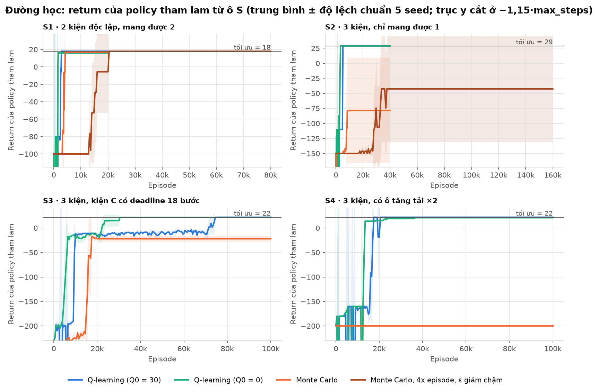
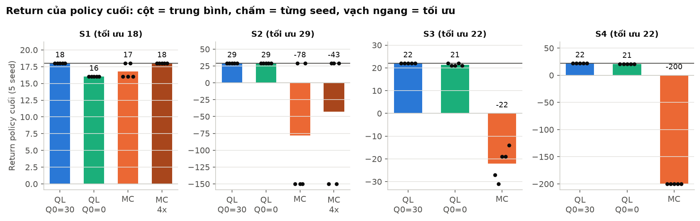

# Đề tài 13 – Multi-Delivery Robot (Q-learning & Monte Carlo)

Robot đi trên lưới ô vuông, nhặt nhiều kiện hàng và giao tới đúng đích. Agent **tự quyết định thứ tự** lấy – giao để được nhiều điểm nhất. Môi trường viết bằng `gymnasium` (dựa theo Taxi-v3), agent học bằng **bảng Q** (Q-learning và Monte Carlo), không dùng DQN hay mạng nơ-ron.

Tài liệu này giải thích **từng file code, từng công thức, luật chơi và các biểu đồ** theo cách đơn giản nhất.

---

## Mục lục

1. [Chạy nhanh](#1-chạy-nhanh)
2. [Cấu trúc thư mục](#2-cấu-trúc-thư-mục)
3. [Luật chơi (cấu trúc trò chơi)](#3-luật-chơi-cấu-trúc-trò-chơi)
4. [Mô hình MDP và toán học](#4-mô-hình-mdp-và-toán-học)
5. [Giải thích từng file code](#5-giải-thích-từng-file-code)
6. [Hai thuật toán học](#6-hai-thuật-toán-học)
7. [Thí nghiệm và biểu đồ](#7-thí-nghiệm-và-biểu-đồ)
8. [Kết quả chính](#8-kết-quả-chính)
9. [Câu hỏi hay gặp khi bảo vệ](#9-câu-hỏi-hay-gặp-khi-bảo-vệ)

---

## 1. Chạy nhanh

```bash
pip install gymnasium numpy matplotlib

python experiments.py          # chạy toàn bộ thí nghiệm (5 seed, khoảng 22 phút với 12 nhân CPU)
python experiments.py --quick  # bản thử nhanh (2 seed, 1/10 số episode, ~20 giây)
python plots.py                # vẽ tất cả biểu đồ vào figures/
python plots.py --lang en      # cùng các biểu đồ nhưng nhãn tiếng Anh, lưu vào figures_en/
python demo.py                 # xem robot chạy 1 episode bằng policy đã học (map S4)
python demo.py --config configs/s2_three_parcels.json --gif   # map khác + lưu ảnh động
```

`demo.py` tự huấn luyện nhanh nếu chưa có bảng Q trong `results/`, nên có thể chạy ngay mà không cần `experiments.py`.

---

## 2. Cấu trúc thư mục

```
Project_RL/
├── configs/                  # 4 file cấu hình map (JSON)
│   ├── s1_two_parcels.json   #   S1: 2 kiện độc lập
│   ├── s2_three_parcels.json #   S2: 3 kiện, chỉ mang được 1
│   ├── s3_deadline.json      #   S3: 1 kiện có deadline
│   └── s4_booster.json       #   S4: có ô tăng tải
├── delivery_env.py           # MÔI TRƯỜNG: trạng thái, mã hóa, hàm chuyển, reward
├── agents.py                 # AGENT: Q-learning, Monte Carlo, ε-greedy, chạy policy tham lam
├── planner.py                # Value Iteration -> return tối ưu (mốc so sánh)
├── experiments.py            # chạy mọi thí nghiệm, lưu vào results/
├── plots.py                  # vẽ biểu đồ vào figures/
├── demo.py                   # demo 1 episode
├── results/                  # kết quả: summary.json, *.npz (đường học), Q_*.npy (bảng Q)
├── figures/                  # các hình PNG dùng cho báo cáo và slide
└── figures_en/               # cùng các hình, nhãn tiếng Anh (plots.py --lang en)
```

Luồng chạy: `configs/*.json` → `delivery_env.py` tạo môi trường → `agents.py` học bảng Q → `experiments.py` lưu số liệu → `plots.py` vẽ hình → `demo.py` chạy thử.

---

## 3. Luật chơi (cấu trúc trò chơi)

### Bản đồ


| Ký hiệu trong file JSON | Ý nghĩa |
| --- | --- |
| `.` | ô trống |
| `#` | tường (không đi vào được) |
| `S` | ô xuất phát của robot khi đánh giá (depot) |
| `B` | ô tăng tải (chỉ có ở S4; trên hình vẽ là ô vàng "×2") |

Mỗi kiện có **điểm lấy** (hình tròn, chữ thường `a b c`) và **điểm giao** (hình vuông, chữ hoa `A B C`).

### Hành động (6 hành động)

| Số | Hành động | Tác dụng |
| --- | --- | --- |
| 0 | Lên | đi lên 1 ô (đâm tường / ra ngoài thì đứng yên) |
| 1 | Xuống | đi xuống 1 ô |
| 2 | Trái | sang trái 1 ô |
| 3 | Phải | sang phải 1 ô |
| 4 | Pickup | nhặt kiện đang chờ ở ô hiện tại (nếu còn chỗ) |
| 5 | Drop | giao kiện đang mang nếu ô hiện tại là đích của nó |

### Điểm thưởng (reward)

| Sự kiện | Reward |
| --- | --- |
| Mỗi bước (kể cả đâm tường) | −1 |
| Giao đúng 1 kiện | +20 (reward theo từng đơn) |
| Pickup/Drop sai chỗ hoặc quá sức chứa | −10 (cộng thêm −1 của bước) |
| Kiện deadline chưa giao khi hết hạn (phạt 1 lần) | −30 |

### Kết thúc

- **Thắng (terminated):** mọi kiện đều đã giao.
- **Hết giờ (truncated):** đi quá `max_steps` bước (100 / 150 / 200 / 200 cho S1–S4).

### 4 setting bắt buộc

| Setting | Lưới | Kiện | Sức chứa | Điểm đặc biệt | Lộ trình tối ưu |
| --- | --- | --- | --- | --- | --- |
| S1 | 5x5 | 2 | 2 | 2 kiện độc lập, mang cùng lúc được | 22 bước, return 18 |
| S2 | 5x5 | 3 | 1 | phải đi lấy – giao từng kiện | 31 bước, return 29 |
| S3 | 6x6 | 3 | 1 | kiện C phải giao trong 18 bước đầu | 38 bước, return 22 |
| S4 | 7x7 | 3 | 1 | qua ô `B` thì mang được 2 kiện, chỉ 1 chuyến | 38 bước, return 22 |

"Lộ trình tối ưu" tính bằng Value Iteration (`planner.py`).

---

## 4. Mô hình MDP và toán học

MDP gồm 5 phần: tập trạng thái S, tập hành động A, hàm chuyển, reward và hệ số chiết khấu γ = 0,99.

### 4.1 Trạng thái là gì?

Mỗi trạng thái là một **tuple 5 phần**:

```
s = (hàng, cột, (σ1, σ2, ..., σN), τ, b)
```

| Thành phần | Giá trị | Ý nghĩa |
| --- | --- | --- |
| hàng, cột | 0..H−1, 0..W−1 | vị trí robot |
| σi | 0 / 1 / 2 | kiện i: **chưa lấy / đang mang / đã giao** |
| τ | 0..T_d | đồng hồ deadline (chỉ S3); các map khác luôn = 0 |
| b | 0 / 1 / 2 | ô tăng tải: **chưa dùng / đang hiệu lực / đã dùng hết** (chỉ S4) |

**Vì sao cần τ và b? (tính Markov)**
Markov nghĩa là: biết trạng thái hiện tại là đủ để biết tương lai, không cần nhớ quá khứ.

- Không có τ: robot ở cùng ô, cùng trạng thái kiện, nhưng lần này còn 10 bước, lần khác đã quá hạn → tương lai khác nhau → vi phạm Markov. Vì vậy phải đưa τ vào trạng thái.
- Không có b: không biết robot đang được mang 2 kiện hay chỉ 1 → hành động Pickup cho kết quả khác nhau → vi phạm Markov.
- Mẹo gộp trạng thái: khi kiện deadline đã giao, đặt τ = T_d (thời gian không còn ảnh hưởng reward) để không sinh ra trạng thái thừa.

### 4.2 Mã hóa trạng thái thành một số nguyên

Bảng Q là mảng 2 chiều `Q[số_trạng_thái, hành_động]`, nên tuple phải đổi thành **một số nguyên**.

**Bước 1 – trạng thái các kiện là một số cơ số 3:**

```
code = σ1·3⁰ + σ2·3¹ + ... + σN·3^(N−1)        (0 ≤ code < 3^N)
```

**Bước 2 – ghép tất cả (giống đổi giờ-phút-giây ra giây):**

```
idx = (((hàng·W + cột)·3^N + code)·T + τ)·B + b
```

**Bước 3 – giải mã** (`decode`) làm ngược lại bằng `divmod` liên tiếp.

**Ví dụ (S3, W = 6, N = 3, T = 19, B = 1):** robot ở (2, 3), A đã giao (2), B đang mang (1), C chưa lấy (0), τ = 7.

```
code = 2·1 + 1·3 + 0·9 = 5
idx  = ((2·6 + 3)·27 + 5)·19 + 7 = (405 + 5)·19 + 7 = 7797
```

Kiểm tra bằng code: `env.encode((2,3,(2,1,0),7,0))` → `7797`, `env.decode(7797)` → `(2,3,(2,1,0),7,0)`.

### 4.3 Kích thước state space

```
|S| = H · W · 3^N · T · B          T = T_d + 1 nếu có deadline, ngược lại 1
                                   B = 3 nếu có ô tăng tải, ngược lại 1
```

| Setting | H·W | 3^N | T | B | \|S\| mã hóa | Trạng thái đạt tới (BFS) | \|A\| |
| --- | --- | --- | --- | --- | --- | --- | --- |
| S1 | 25 | 9 | 1 | 1 | 225 | 186 | 6 |
| S2 | 25 | 27 | 1 | 1 | 675 | 364 | 6 |
| S3 | 36 | 27 | 19 | 1 | 18 468 | 2 825 | 6 |
| S4 | 49 | 27 | 1 | 3 | 3 969 | 2 347 | 6 |


Số trạng thái **đạt tới** nhỏ hơn vì: không đứng trên tường được; sức chứa 1 nên không có 2 kiện cùng σ = 1 (còn 20/27 tổ hợp); τ, b chỉ nhận giá trị đi tới được. Hàm `reachable_states()` đếm bằng BFS.

### 4.4 Hàm chuyển (transition) – từng bước

Hàm `transition(state, action)` trong `delivery_env.py` làm đúng 4 việc:

1. **Di chuyển:** tính ô mới; nếu ngoài lưới hoặc là tường thì đứng yên. Bước vào ô tăng tải khi b = 0 → b = 1.
2. **Pickup:** sức chứa = 2 nếu b = 1, ngược lại `capacity`. Có kiện σ = 0 tại ô này và số kiện đang mang < sức chứa → σ = 1. Ngược lại phạt −10.
3. **Drop:** có kiện đang mang (σ = 1) mà đích là ô này → σ = 2, cộng reward của đơn. Nếu b = 1 và robot vừa trống tay → b = 2 (hết chuyến tăng tải). Ngược lại phạt −10.
4. **Đồng hồ deadline:** kiện deadline đã giao → τ = T_d; chưa giao → τ tăng 1 (dừng ở T_d), đúng lúc chạm T_d thì phạt −30.

Môi trường **tất định**: cùng (s, a) luôn ra cùng s'. Kết thúc khi mọi σ = 2.

---

## 5. Giải thích từng file code

### 5.1 `configs/*.json` – file cấu hình map

```json
{
  "name": "S3_kien_deadline",
  "grid": ["S.....", ".##.#.", ...],          // bản đồ, mỗi chuỗi là 1 hàng
  "capacity": 1,                              // số kiện mang được cùng lúc
  "parcels": [                                // danh sách kiện
    {"name": "C", "pickup": [5, 5], "drop": [5, 0], "reward": 20, "deadline": 18}
  ],
  "rewards": {"step": -1, "illegal": -10, "late_penalty": 30},
  "max_steps": 200,
  "train": {"episodes": 100000, "gamma": 0.99, "alpha_ql": 0.5, "start_mode": "random_cell",
            "eps_start": 1.0, "eps_end": 0.05, "decay_frac": 0.7, "eval_every": 500,
            "best_ql": "ql_opt"}
}
```

Muốn tạo map mới: copy một file, sửa `grid` và `parcels`. Không cần sửa code.

### 5.2 `delivery_env.py` – môi trường

| Hàm / biến | Làm gì |
| --- | --- |
| `UP, DOWN, LEFT, RIGHT, PICKUP, DROP` | số hiệu 6 hành động (0..5) |
| `WAITING, CARRYING, DELIVERED` | 3 trạng thái kiện (0, 1, 2) |
| `__init__(config, start_mode)` | đọc map, tìm tường / ô S / ô B, tính `n_pos`, `n_codes = 3^N`, `n_tau`, `n_boost`, `n_states`; khai báo `observation_space = Discrete(n_states)`, `action_space = Discrete(6)` |
| `encode(state)` | tuple → số nguyên (công thức mục 4.2) |
| `decode(idx)` | số nguyên → tuple |
| `transition(state, action)` | **trái tim của trò chơi** (mục 4.4); trả về `(s', reward, terminated, event)` |
| `reachable_states()` | BFS từ mọi ô xuất phát để đếm trạng thái đạt tới |
| `reset()` | đặt robot ở ô xuất phát, mọi kiện σ = 0, τ = 0, b = 0 |
| `step(action)` | gọi `transition`, tăng bộ đếm bước, báo `truncated` khi hết `max_steps` |
| `render()` | vẽ map bằng chữ: `@` robot, `a/b/c` kiện chờ, `A/B/C` đích, `*` đã giao, `+` ô tăng tải (`o` khi đã kích hoạt) |

Ba chế độ xuất phát (`start_mode`):

- `"depot"` – luôn ở ô S. Dùng để **đánh giá** policy.
- `"random_cell"` – ô trống ngẫu nhiên, mọi kiện chưa lấy (giống Taxi). Dùng để **huấn luyện**: robot ghé được nhiều ô hơn.
- `"exploring"` – trạng thái ngẫu nhiên bất kỳ (exploring starts). Đã thử, không dùng trong kết quả cuối.

### 5.3 `agents.py` – hai thuật toán

| Hàm | Làm gì |
| --- | --- |
| `epsilon_at(ep, ...)` | ε giảm tuyến tính: `ε = ε_start + min(1, ep / (decay_frac·n_episodes))·(ε_end − ε_start)` |
| `eps_greedy(Q, s, eps, rng)` | xác suất ε chọn ngẫu nhiên; còn lại chọn `argmax Q[s]` (hòa thì bốc ngẫu nhiên) |
| `run_greedy(env, Q)` | chạy 1 episode với ε = 0, trả về return, có thành công không, số bước, quỹ đạo, các sự kiện |
| `q_learning(...)` | Q-learning, cập nhật sau mỗi bước (mục 6.1) |
| `monte_carlo(...)` | Monte Carlo first-visit, cập nhật sau cả episode (mục 6.2) |

Cả hai hàm học đều trả về `(Q, hist)`. `hist` lưu return và độ dài mỗi episode huấn luyện, cùng kết quả đánh giá tham lam định kỳ (để vẽ đường học).

### 5.4 `planner.py` – Value Iteration (mốc tối ưu)

Vì môi trường nhỏ và tất định, ta liệt kê được mọi trạng thái rồi lặp phương trình Bellman tối ưu tới khi hội tụ:

```
V(s) ← max_a [ r(s,a) + γ · V(s') ]      (V = 0 ở trạng thái kết thúc)
```

Kết quả cho biết **return tốt nhất có thể** (đường ngang "tối ưu" trên các biểu đồ). Đây chỉ là thước đo, không phải thuật toán học được so sánh.

### 5.5 `experiments.py` – chạy thí nghiệm

1. Với mỗi map: tính |S|, số trạng thái đạt tới, lộ trình tối ưu.
2. **Phần 1:** mỗi map × các biến thể (`ql_q0`, `ql_opt`, `mc`, và `mc_long` trên S1, S2) × 5 seed, chạy song song bằng `multiprocessing.Pool`.
3. **Phần 2:** đổi reward / tham số môi trường (phạt trễ 0 hay 30, deadline 18 hay 35, có hay không ô tăng tải), mỗi biến thể 5 seed.
4. Lưu `results/summary.json`, `results/<map>.npz` (đường học), `results/Q_*.npy` (bảng Q của seed 0).

### 5.6 `plots.py` – vẽ biểu đồ

Đọc `results/` và vẽ 11 hình vào `figures/` (mục 7). Thêm `--lang en` để vẽ cùng các hình với nhãn tiếng Anh vào `figures_en/` (dùng cho báo cáo tiếng Anh). Hàm `L(vi, en)` chọn chuỗi theo ngôn ngữ.

### 5.7 `demo.py` – demo 1 episode

Đọc bảng Q đã học (hoặc tự huấn luyện nhanh), chạy policy tham lam từ ô S, in map dạng chữ sau mỗi bước kèm hành động, reward và sự kiện. Thêm `--gif` để lưu ảnh động.

---

## 6. Hai thuật toán học

Cả hai đều học bảng **Q(s, a)** = "nếu đang ở s, làm a rồi sau đó chơi tốt, thì được tổng bao nhiêu điểm (có chiết khấu)". Học xong, policy là: ở mỗi trạng thái chọn hành động có Q lớn nhất.

### 6.1 Q-learning (học sau từng bước)

```
Q(s,a) ← Q(s,a) + α · [ r + γ · max_a' Q(s',a') − Q(s,a) ]
                        └──────── mục tiêu ────────┘
```

- `r + γ·max Q(s')`: điểm vừa nhận + giá trị tốt nhất ước lượng từ ô kế tiếp (**bootstrap**).
- α = 0,5: học nhanh, an toàn vì môi trường tất định.
- Nếu bước đó **kết thúc thật** (giao hết hàng) thì mục tiêu chỉ là r. Nếu chỉ **hết giờ** thì vẫn cộng γ·max Q(s').

**Ví dụ số:** Q(s,a) = 0, r = −1, γ = 0,99, max Q(s') = 10, α = 0,5
→ mục tiêu = −1 + 0,99·10 = 8,9 → Q mới = 0 + 0,5·(8,9 − 0) = **4,45**.

### 6.2 Monte Carlo first-visit (học sau cả episode)

1. Chạy hết một episode bằng ε-greedy, ghi lại (s, a, r) từng bước.
2. Tính return **ngược từ cuối**: `G_t = r_{t+1} + γ·G_{t+1}`.
3. Với mỗi cặp (s, a), chỉ dùng **lần đầu tiên** nó xuất hiện: `N(s,a) += 1`, `Q(s,a) += (G − Q(s,a)) / N(s,a)` (trung bình mẫu).

**Ví dụ số:** 3 bước cuối có reward −1, −1, +19 (bước Drop: −1 + 20):
G₂ = 19 → G₁ = −1 + 0,99·19 = 17,81 → G₀ = −1 + 0,99·17,81 = **16,63**.

### 6.3 Khác biệt cốt lõi

| | Q-learning | Monte Carlo |
| --- | --- | --- |
| Cập nhật khi nào | sau mỗi bước | sau cả episode |
| Mục tiêu | r + γ·max Q(s') (bootstrap) | return thật G |
| Nhiễu của mục tiêu | thấp (môi trường tất định) | cao (phụ thuộc mọi hành động ngẫu nhiên phía sau) |
| Cần episode kết thúc? | không | có (episode bị cắt thì return sai lệch) |
| Policy học được | tham lam (off-policy) | ε-greedy (on-policy) |

### 6.4 Hai biến thể Q-learning

- **Q₀ = 0:** mọi Q ban đầu bằng 0, thấp hơn giá trị thật (khoảng +10 đến +20) nên nhánh chưa thử trông kém, agent dễ bám lộ trình đầu tiên tìm được.
- **Q₀ = 30 (lạc quan):** nhánh chưa thử trông rất tốt nên agent tự đi thử. Biến thể này đạt tối ưu ở cả 4 map nên được dùng cho hình policy và các thí nghiệm đổi reward (`best_ql` trong config).

---

## 7. Thí nghiệm và biểu đồ

Huấn luyện: robot xuất phát ở ô ngẫu nhiên; ε giảm 1,0 → 0,05 trong 70% số episode; γ = 0,99; số episode S1: 20 000 · S2: 40 000 · S3: 100 000 · S4: 100 000 (Monte Carlo bản kéo dài gấp 4). Cứ 100–500 episode lại chạy **policy tham lam từ ô S** để đo return. Mỗi biến thể chạy 5 seed.

| Hình | Cho thấy |
| --- | --- |
| `figures/maps.png` | 4 map, vị trí lấy / giao, tường, ô tăng tải |
| `figures/state_space.png` | \|S\| mã hóa và số trạng thái đạt tới (thang log) |
| `figures/learning_curves.png` | đường học: return theo episode, trung bình ± độ lệch chuẩn 5 seed |
| `figures/success_rate.png` | tỉ lệ seed giao đủ hàng theo episode |
| `figures/episode_length.png` | số bước mỗi episode khi huấn luyện |
| `figures/final_returns.png` | return cuối của từng seed so với tối ưu |
| `figures/policy_S2.png`, `policy_S4.png`, `policy_S3.png` | policy cuối: mũi tên = hành động tham lam ở mỗi ô, từng "pha" (đang mang kiện nào), đường màu = đường đi thật |
| `figures/reward_deadline.png` | S3 khi đổi phạt trễ và độ dài deadline |
| `figures/env_booster.png` | S4 có và không có ô tăng tải |

**Cách đọc hình policy:** mỗi ô nhỏ là một "pha" (ví dụ "đang mang C · tăng tải BẬT"). Mũi tên xám là hành động policy chọn nếu robot đứng ở ô đó trong pha này; chữ `P`/`D` là Pickup/Drop. Đường màu là đường robot thực sự đi: màu theo kiện đang mang, xám là tay không, đen là mang 2 kiện.

---

## 8. Kết quả chính





### 8.1 Bảng tổng hợp (policy tham lam cuối cùng, 5 seed)

| Map | Biến thể | Số episode | Return cuối (5 seed) | Giao đủ hàng | Đạt tối ưu | Episode đầu tiên đạt tối ưu |
| --- | --- | --- | --- | --- | --- | --- |
| S1 (tối ưu 18) | Q-learning Q₀ = 30 | 20 000 | 18 (cả 5) | 5/5 | 5/5 | 2 500 – 2 700 |
| | Q-learning Q₀ = 0 | 20 000 | 16 (cả 5) | 5/5 | 0/5 | 1 400 – 1 500, sau đó mất |
| | Monte Carlo | 20 000 | 16, 18, 16, 18, 16 | 5/5 | 2/5 | 3 500 – 3 700 |
| | Monte Carlo 4x, ε giảm chậm | 80 000 | 18 (cả 5) | 5/5 | 5/5 | 13 200 – 20 400 |
| S2 (tối ưu 29) | Q-learning Q₀ = 30 | 40 000 | 29 (cả 5) | 5/5 | 5/5 | 5 000 – 5 200 |
| | Q-learning Q₀ = 0 | 40 000 | 29 (cả 5) | 5/5 | 5/5 | 2 800 – 3 400 |
| | Monte Carlo | 40 000 | −150, 29, −150, −150, 29 | 2/5 | 2/5 | 7 800 – 11 400 |
| | Monte Carlo 4x, ε giảm chậm | 160 000 | −150, 29, 29, −150, 29 | 3/5 | 3/5 | 28 000 – 29 600 |
| S3 (tối ưu 22) | Q-learning Q₀ = 30 | 100 000 | 22 (cả 5) | 5/5, đúng hạn | 5/5 | 71 000 – 75 500 |
| | Q-learning Q₀ = 0 | 100 000 | 22, 21, 21, 22, 21 | 5/5, đúng hạn | 2/5 | 22 000 – 30 500 |
| | Monte Carlo | 100 000 | −27, −31, −19, −19, −14 | 5/5, đều trễ hạn | 0/5 | – |
| S4 (tối ưu 22) | Q-learning Q₀ = 30 | 100 000 | 22 (cả 5) | 5/5 | 5/5 | 16 500 – 17 500 |
| | Q-learning Q₀ = 0 | 100 000 | 21 (cả 5) | 5/5 | 0/5 | – |
| | Monte Carlo | 100 000 | −200 (cả 5) | 0/5 | 0/5 | – |

Return −150 / −200 nghĩa là policy **lặp vòng** tới hết `max_steps`. Thời gian mỗi seed: Q-learning 14–149 giây, Monte Carlo 10–219 giây (máy 12 nhân, chạy song song).

### 8.2 Ảnh hưởng của số episode

Lượt chạy đầu dùng ít episode hơn (S1 5 000, S2 10 000, S3 40 000, S4 30 000). Tăng episode giúp Q-learning rõ rệt, còn Monte Carlo chỉ khá lên ở map nhỏ:

| Trường hợp | Ít episode | Nhiều episode |
| --- | --- | --- |
| S3, Q-learning Q₀ = 30 | 40 000 ep: tối ưu 2/5, 1 seed trễ hạn | 100 000 ep: tối ưu 5/5 |
| S4, Q-learning Q₀ = 0 | 30 000 ep: return 14, không dùng ô tăng tải | 100 000 ep: return 21, có dùng ô tăng tải (dư 1 bước) |
| S1, Monte Carlo | 5 000 ep: giao đủ 3/5 | 20 000 ep: giao đủ 5/5, tối ưu 2/5 |
| S2, Monte Carlo | 10 000 ep: 1/5 | 40 000 ep: 2/5 |
| S4, Monte Carlo | 30 000 ep: 0/5 | 100 000 ep: 0/5 |
| S3 deadline 35 (thí nghiệm 8.4) | Q₀ = 0, 80 000 ep: vẫn giao C trước | Q₀ = 30, 200 000 ep: đổi sang A → B → C, tối ưu |

### 8.3 Nhận xét

1. **Q-learning Q₀ = 30 đạt tối ưu 5/5 seed ở cả 4 map.** S3 khó nhất: phải tới khoảng 71 000–75 500 episode mới chạm tối ưu, vì chiều τ nhân số trạng thái lên 19 lần.
2. **Q₀ = 0 hội tụ sớm hơn nhưng dễ kẹt ở lộ trình kém.** Ở S1 nó luôn lấy B trước (24 bước thay vì 22). Ở S4 nó dùng ô tăng tải nhưng vẫn dư 1 bước. Lý do: giá trị thật (+10 đến +20) cao hơn 0, nên hành động chưa thử bị đánh giá thấp và khi ε nhỏ thì không được thử lại. Q₀ = 30 làm ngược lại: hành động chưa thử trông hấp dẫn nên agent tự đi khám phá.
3. **Monte Carlo thất bại hoặc hội tụ chậm**, vì 3 lý do:
   - *Không bootstrap:* MC cần cả episode. Ở S4, đi ngẫu nhiên gần như không bao giờ giao đủ 3 kiện trong 200 bước, nên mọi return đều ≈ −200, không có tín hiệu học (`episode_length.png`).
   - *Return nhiễu hơn khoảng cách giữa các hành động:* trong môi trường tất định, hành động "phí 1 bước" (đâm tường) chỉ kém hành động tốt nhất 1–2 điểm, còn return MC dao động hàng chục điểm do ε-khám phá. Chỉ cần một ô ước lượng sai thứ tự là policy tham lam đứng đâm tường mãi. Ví dụ đo được ở S1 (một lần chạy thử 10 000 episode): tại ô lấy kiện A, Q của MC đều trong khoảng −72 đến −108 trong khi giá trị thật là +16 đến +18, nên "đâm tường" thắng.
   - *Trung bình 1/N nhớ quá khứ:* return của giai đoạn đi ngẫu nhiên đầu (rất âm) có trọng số bằng giai đoạn sau, nên MC "quên" chậm.
4. **Kết quả MC dao động mạnh theo seed và ngân sách.** MC 4x trên S2 đạt 5/5 khi chạy 40 000 episode ở lượt đầu, nhưng chỉ 3/5 khi chạy 160 000 episode ở lượt này. Thêm episode không chắc chữa được lỗi lặp vòng.
5. **MC ở S3** luôn giao đủ hàng nhưng đều trễ hạn: nó không học được việc ưu tiên kiện deadline.

### 8.4 Thí nghiệm đổi reward / tham số môi trường


| Biến thể (Q-learning Q₀ = 30, 5 seed, gấp đôi số episode) | Tối ưu (Value Iteration) | Agent học được |
| --- | --- | --- |
| S3 gốc: deadline 18, phạt trễ 30 | C → B → A, 38 bước, return 22 | C → B → A, 38 bước, đúng hạn (5/5) |
| S3: deadline 18, **phạt trễ 0** | A → B → C, 29 bước, return 31 (trễ) | A → B → C, 29–30 bước (5/5) |
| S3: **deadline 35**, phạt trễ 30 | A → B → C, 29 bước, return 31 (đúng hạn) | A → B → C, 29–30 bước, đúng hạn (5/5) |
| S4 gốc: có ô tăng tải | C → B → A, 38 bước, return 22 | giống tối ưu (5/5) |
| S4: **bỏ ô tăng tải** | B → C → A, 46 bước, return 14 | giống tối ưu (5/5) |

- **Phạt trễ 30 → 0 (cấu hình reward):** policy đổi thứ tự. Khi trễ hạn không bị phạt, đi vòng A → B → C ngắn hơn 9 bước nên agent bỏ ưu tiên kiện C.
- **Deadline 18 → 35 (tham số môi trường):** giao C cuối vẫn kịp hạn, nên agent cũng chuyển sang A → B → C ngắn hơn. Lượt đầu (Q₀ = 0, 80 000 episode) agent chưa đổi được vì số trạng thái đạt tới tăng từ 2 825 lên 8 210; cần khởi tạo lạc quan và nhiều episode hơn.
- **Bỏ ô tăng tải (tham số môi trường):** lộ trình dài thêm 8 bước (46 so với 38). Khi có ô tăng tải, robot đi qua ô `×2`, lấy C rồi A (mang 2), giao C trên đường về, rồi lấy thêm B. Chuyến tăng tải chưa kết thúc vì tay robot chưa trống, nên lại mang được 2 kiện, rồi giao B và A ở góc dưới.


### 8.5 Policy cuối cùng


---

## 9. Câu hỏi hay gặp khi bảo vệ

**Vì sao không đưa "số kiện đang mang" vào trạng thái?**
Vì đã suy ra được: bằng số σi = 1.

**Vì sao trạng thái đạt tới ít hơn |S| mà bảng Q vẫn cấp phát đủ |S|?**
Cho đơn giản: chỉ số = công thức `encode`, không cần bảng tra. Bảng lớn nhất 18 468 × 6 số thực (~0,9 MB).

**Vì sao đánh giá bằng policy tham lam từ ô S?**
Đề yêu cầu xem chính sách cuối cùng. Môi trường tất định nên một lần chạy là đủ, không có ngẫu nhiên.

**Vì sao chọn Q₀ = 30 làm bản Q-learning chính?**
Vì nó đạt tối ưu 5/5 seed ở cả 4 map khi đủ episode (mục 8.1). Q₀ = 0 học nhanh hơn lúc đầu nhưng kẹt ở lộ trình kém hơn ở S1, S3, S4.

**Vì sao tăng số episode?**
Với ít episode, S3 chỉ tối ưu 2/5 seed và thí nghiệm deadline 35 chưa đổi được thứ tự (mục 8.2). ε giảm trong 70% số episode, nên nhiều episode hơn cũng có nghĩa là khám phá lâu hơn.

**Truncation khác terminal thế nào?**
Terminal = giao hết hàng, tương lai bằng 0. Truncation = hết `max_steps`, trò chơi chưa thật sự kết thúc, nên Q-learning vẫn cộng γ·max Q(s').
