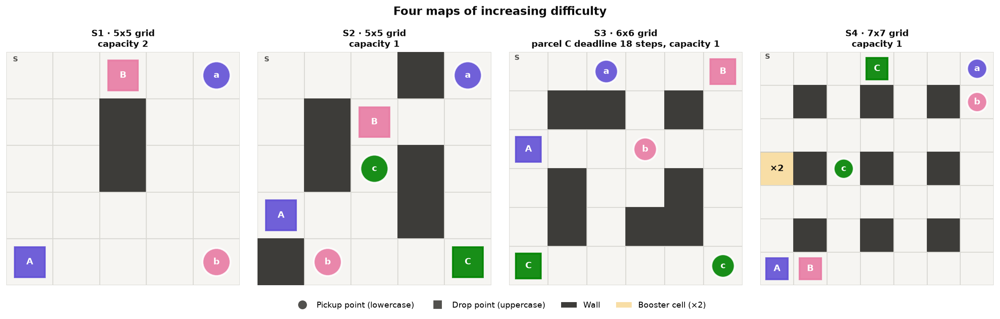
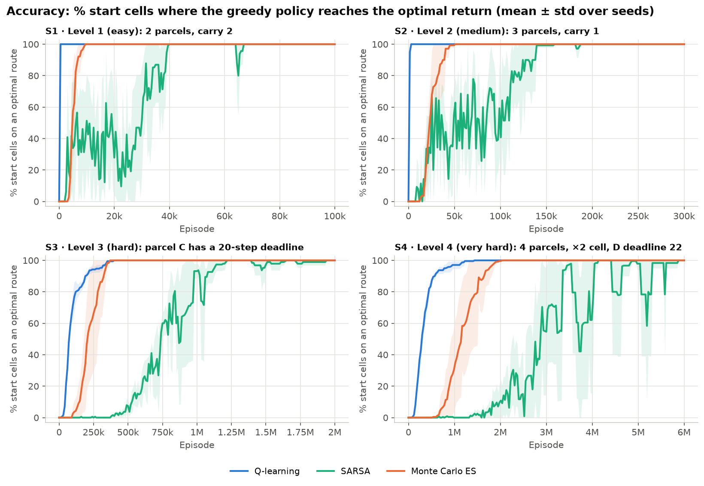
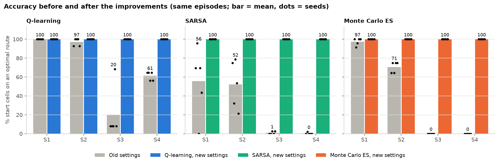
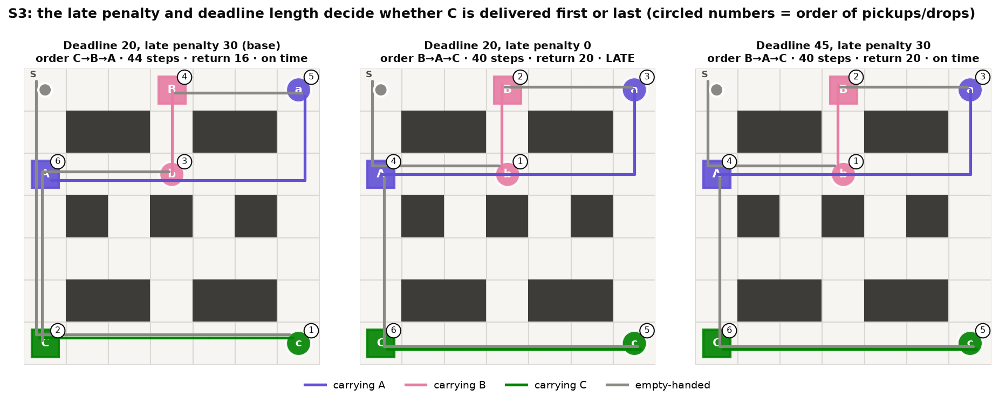
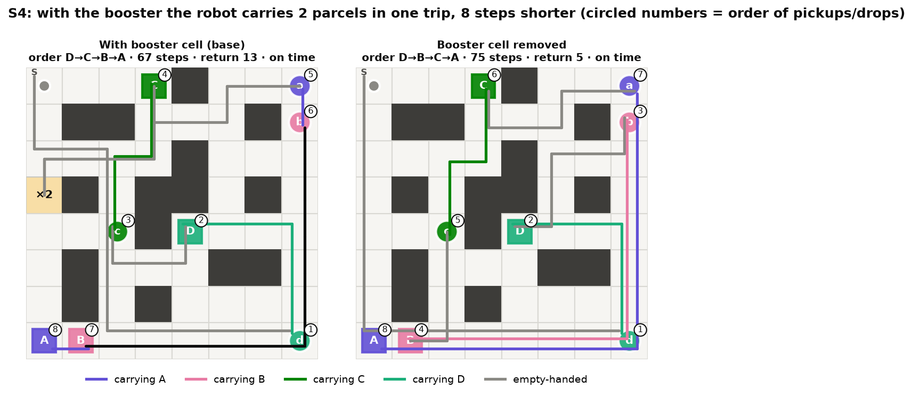
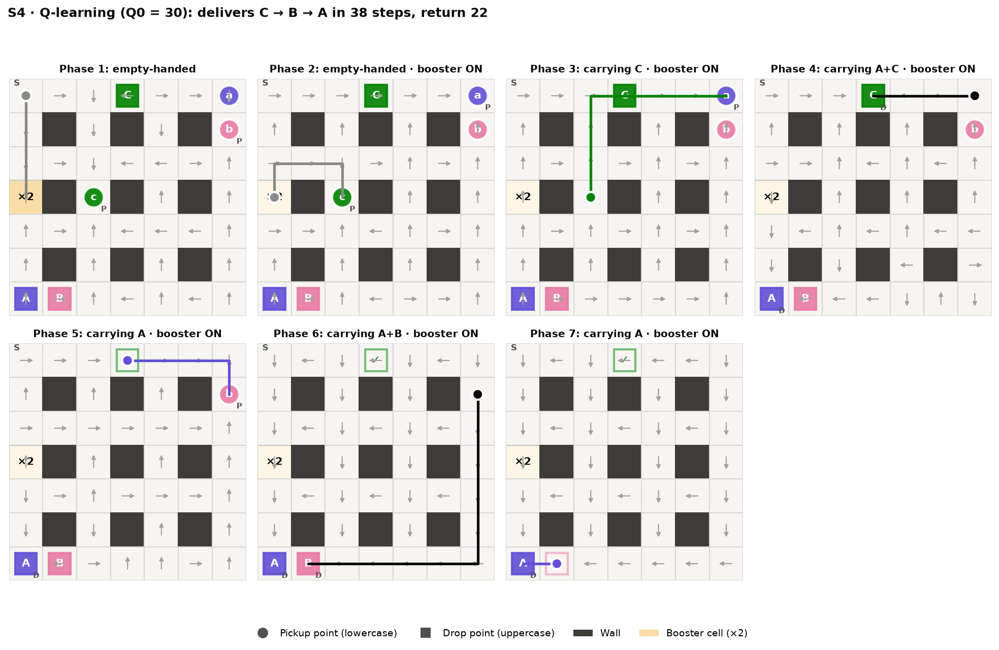
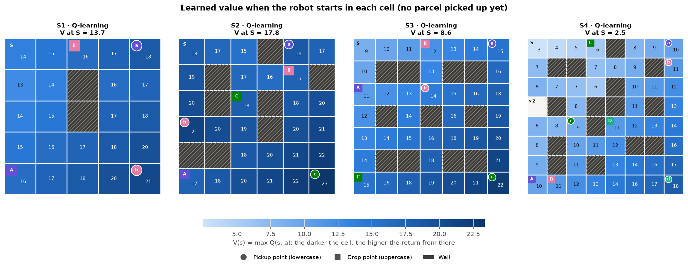
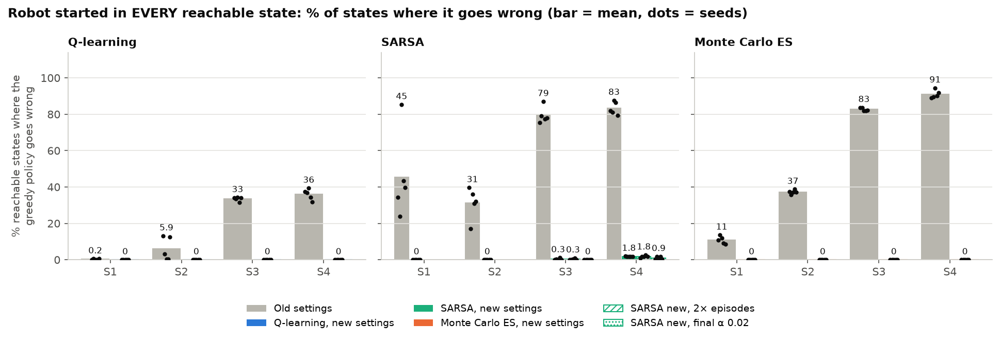
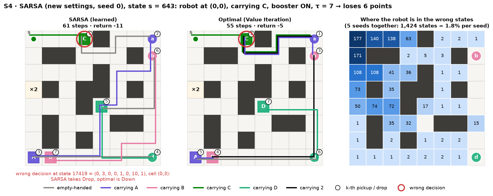

# Topic 13 – Multi-Delivery Robot (Q-learning, SARSA & Monte Carlo)

A robot moves on a grid, picks up several parcels and delivers each one to its destination. The agent **decides the pickup and delivery order by itself** to collect as many points as possible. The environment is written with `gymnasium` (based on Taxi-v3), and the agent learns a **Q table** with three algorithms: **Q-learning**, **SARSA** and **Monte Carlo ES**. No DQN or neural network is used.

There are **4 maps of increasing difficulty**. Each level adds one new mechanic: more parcels, capacity 1, a deadline, a booster cell.

After the improvements, all three algorithms reach **100% accuracy on all 4 maps in 5/5 seeds**. Accuracy here is the share of start cells from which the policy follows an optimal route. The training loops are compiled with `numba`, about 150–180 times faster than plain Python, so millions of episodes run in a few tens of seconds.

This document explains **every code file, every formula, the rules and the figures** as simply as possible. The course report and slides are in `Nguyen_Quang_Trungg-22011211/`.

---

## Contents

1. [Quick start (local machine and Google Colab)](#1-quick-start-local-machine-and-google-colab)
2. [Folder structure](#2-folder-structure)
3. [Rules and the 4 levels](#3-rules-and-the-4-levels)
4. [MDP model and the maths](#4-mdp-model-and-the-maths)
5. [Every code file explained](#5-every-code-file-explained)
6. [The three learning algorithms and the improvements](#6-the-three-learning-algorithms-and-the-improvements)
7. [Experiments and figures](#7-experiments-and-figures)
8. [Main results](#8-main-results)
9. [Questions to expect at the defence](#9-questions-to-expect-at-the-defence)
10. [Symbol table: maths ↔ code](#10-symbol-table-maths--code)

---

## 1. Quick start (local machine and Google Colab)

### On your own machine

```bash
pip install gymnasium numpy matplotlib numba

python experiments.py                # all experiments, 5 seeds (about 4 minutes on 12 CPU cores)
python experiments.py --quick        # quick test (2 seeds, 1/20 of the episodes, about 20 seconds)
python experiments.py --scale 2      # double the episodes on every map (longer training)
python experiments.py --no-baseline  # skip the comparison with the old settings (twice as fast)
python plots.py                      # draw every figure into figures/ (Vietnamese labels)
python plots.py --lang en            # the same figures with English labels, saved to figures_en/
python convergence.py                # retrain while measuring how Q converges to Q* (about 1–2 minutes), draws 2 figures
python convergence.py --plot-only --lang en   # only redraw from results/convergence.npz, English labels
python failure_cases.py              # put the robot in EVERY reachable state, find where it goes wrong (about 3–4 minutes)
python failure_cases.py --plot-only --lang en  # only redraw from results/failure_cases.json, English labels
python demo.py                       # watch the robot run 1 episode with the learned policy (map S4)
python demo.py --config configs/s2_three_parcels.json --algo sarsa --gif   # another map and algorithm, save an animation
python play.py                       # play yourself with the keyboard: W/A/S/D move, J picks up, K drops (map S1)
python play.py --config configs/s4_booster.json   # play another map
python app.py                        # desktop app: train with live view + control the robot (Vietnamese UI)
python app.py --lang en              # the same app with an English UI
```

`demo.py` trains by itself if there is no Q table in `results/` yet, so it can run without `experiments.py`. Without `numba` the code still runs (plain Python), only much slower.

### On Google Colab

Open `colab_train.ipynb` in Colab (File → Upload notebook) and run the cells in order. The notebook can get the code in two ways:

- **`drive`** *(recommended)*: copy the whole `Project_RL` folder to Google Drive as `MyDrive/Project_RL`. Results are written straight to Drive.
- **`github`**: clone `https://github.com/Qwup2112/multi-delivery-robot-rl.git`. Push your latest code first. The last cell zips the results for download.

The notebook installs `numba`, runs a `--quick` test and the full run, draws the figures, measures convergence, makes the animation and prints the accuracy table. Change `SCALE` in the training cell to add episodes.

> **Speed note:** tabular reinforcement learning runs on the CPU; a GPU does not help. Free Colab usually has 2 CPU cores, so a full run takes an estimated 30–45 minutes. A 12-core machine does the same in about 5 minutes. Colab is useful when you want to keep your own machine free during training. The real speed-up comes from `numba` (Section 5.3).

---

## 2. Folder structure

```
Project_RL/
├── configs/                  # 4 map configuration files (JSON), level 1 → 4
│   ├── s1_two_parcels.json   #   S1 · level 1 (easy): 2 parcels, carry 2
│   ├── s2_three_parcels.json #   S2 · level 2 (medium): 3 parcels, carry 1
│   ├── s3_deadline.json      #   S3 · level 3 (hard): parcel C has a deadline
│   └── s4_booster.json       #   S4 · level 4 (very hard): 4 parcels, booster cell + parcel D with a deadline
├── delivery_env.py           # ENVIRONMENT: state, encoding, transition, reward, precomputed transition tables
├── agents.py                 # AGENTS: Q-learning, SARSA, Monte Carlo (compiled with numba), greedy rollouts
├── planner.py                # Value Iteration -> optimal return (reference)
├── experiments.py            # runs every experiment, saves to results/
├── plots.py                  # draws the figures into figures/ (figures_en/ with --lang en)
├── convergence.py            # measures and plots how the Q table converges to Q* (Value Iteration)
├── failure_cases.py          # starts the robot in every reachable state: where does each policy go wrong, and at which state code
├── demo.py                   # 1-episode demo
├── play.py                   # play yourself with the keyboard (W/A/S/D, J, K)
├── app.py                    # desktop app (Tkinter): train with a live view, control the robot, inspect state codes
├── colab_train.ipynb         # notebook that runs everything on Google Colab
├── Nguyen_Quang_Trungg-22011211/   # report (Word) + slides + IEEE paper (LaTeX), all in English
│   ├── IEEE_Paper/               #   main.tex (IEEE conference template) + figures/
│   ├── IEEE_Paper_Overleaf.zip   #   the same, ready for Overleaf: New Project → Upload Project
│   └── Formulation/              #   formulation.tex: equations of the environment (MDP) and the 3 algorithms
├── results/                  # results: summary.json, *.npz (learning curves), Q_*.npz (Q tables), log.txt (log of the full run),
│                             #   failure_cases.json + failure_states.csv (every wrong state with its state code)
├── figures/                  # PNG figures with Vietnamese labels
└── figures_en/               # the same figures with English labels (plots.py --lang en), used in the report and slides
```

Pipeline: `configs/*.json` → `delivery_env.py` builds the environment and precomputes the transitions → `agents.py` learns the Q table → `experiments.py` saves the numbers → `plots.py` draws the figures → `demo.py` runs a demo.

> **Note on names:** code comments, printed messages and some names are in Vietnamese without diacritics. Useful words: *kien* = parcel, *lay* = pick up, *giao* = deliver, *sai* = wrong, *tre* = late, *phat* = penalty, *cu* = old (old settings), *o tang tai* = booster cell, *suc chua* = capacity, *doc lap* = independent, *co* / *khong* = with / without. Examples: `S3_kien_deadline` = "S3, parcel with a deadline", `S4_khong_tang_tai` = "S4 without the booster cell", `ql_cu` = Q-learning with the old settings.

---

## 3. Rules and the 4 levels

### Map



| Symbol in the JSON file | Meaning |
| --- | --- |
| `.` | empty cell |
| `#` | wall (cannot be entered) |
| `S` | the robot's start cell for evaluation (depot) |
| `B` | booster cell (S4 only; drawn as the yellow "×2" cell) |

Each parcel has a **pickup cell** (circle, lowercase `a b c d`) and a **drop cell** (square, uppercase `A B C D`).

### Actions (6 actions)

| No. | Action | Key (`play.py`) | Effect |
| --- | --- | --- | --- |
| 0 | Up | W | move up 1 cell (bumping into a wall or the edge: stay in place) |
| 1 | Down | S | move down 1 cell |
| 2 | Left | A | move left 1 cell |
| 3 | Right | D | move right 1 cell |
| 4 | Pickup | J | pick up the parcel waiting in the current cell (if there is room) |
| 5 | Drop | K | deliver a carried parcel if the current cell is its drop cell |

### Rewards

| Event | Reward |
| --- | --- |
| Every step (including bumping into a wall) | −1 |
| Correct delivery of 1 parcel | +20 (per-order reward) |
| Pickup/Drop in the wrong cell or over capacity | −10 (on top of the −1 for the step) |
| Deadline parcel not delivered when time runs out (once) | −30 |

### End of an episode

- **Win (terminated):** every parcel has been delivered.
- **Time-out (truncated):** more than `max_steps` steps (100 / 150 / 200 / 300 for S1–S4).

### 4 levels of increasing difficulty

Each level adds **one new mechanic** to the previous one, and the grid also grows:

| Level | Map | Grid | Parcels | Capacity | New mechanic | Optimal route |
| --- | --- | --- | --- | --- | --- | --- |
| 1 · easy | S1 | 5x5 | 2 | 2 | both parcels can be carried together | A → B, 22 steps, return 18 |
| 2 · medium | S2 | 6x6 | 3 | 1 | only 1 parcel at a time, so the order matters | B → A → C, 36 steps, return 24 |
| 3 · hard | S3 | 7x7 | 3 | 1 | parcel C must be delivered within the first 20 steps | C → B → A, 44 steps, return 16 |
| 4 · very hard | S4 | 8x8 | 4 | 1 | booster cell `B` (carry 2 in one trip) **and** a 22-step deadline for parcel D | D → C → B → A, 67 steps, return 13 |

"Optimal route" is computed with Value Iteration (`planner.py`). Difficulty grows on every measure: reachable states (186 → 535 → 4,027 → 15,612), optimal route length (22 → 36 → 44 → 67 steps) and the trade-offs to learn:

- **S3:** without the deadline, B → A → C would be shorter (40 steps). The deadline forces the robot to deliver C first even though the total route is 4 steps longer.
- **S4:** the robot must deliver D first to meet its deadline, then detour via the ×2 cell to carry A and B in one trip. Without the booster cell the route is 8 steps longer (Section 8.5).

---

## 4. MDP model and the maths

The MDP has 5 parts: the state set S, the action set A, the transition function, the reward and the discount factor γ = 0.99.

### 4.1 What is a state?

Each state is a **5-part tuple**:

```
s = (row, col, (σ1, σ2, ..., σN), τ, b)
```

| Component | Values | Meaning |
| --- | --- | --- |
| row, col | 0..H−1, 0..W−1 | robot position |
| σi | 0 / 1 / 2 | parcel i: **waiting / carried / delivered** |
| τ | 0..T_d | deadline clock (S3, S4); always 0 on the other maps |
| b | 0 / 1 / 2 | booster: **unused / active / used up** (S4 only) |

**Why are τ and b needed? (the Markov property)**
Markov means that the current state is enough to predict the future; the past does not need to be remembered.

- Without τ: the robot is in the same cell with the same parcel statuses, but one time there are 10 steps left and another time the deadline has passed → different futures → the Markov property is violated. So τ must be part of the state.
- Without b: we cannot tell whether the robot may carry 2 parcels or only 1 → Pickup gives different results → the Markov property is violated.
- State-merging trick: once the deadline parcel is delivered, τ is set to T_d (time no longer affects the reward), so no redundant states are created.

### 4.2 Encoding a state as one integer

The Q table is a 2-D array `Q[state_index, action]`, so the tuple must become **one integer**.

**Step 1 – the parcel statuses form a base-3 number:**

```
code = σ1·3⁰ + σ2·3¹ + ... + σN·3^(N−1)        (0 ≤ code < 3^N)
```

**Step 2 – pack everything (like converting hours-minutes-seconds into seconds):**

```
idx = (((row·W + col)·3^N + code)·T + τ)·B + b
```

**Step 3 – decoding** (`decode`) reverses this with successive `divmod` calls.

**Example (S3, W = 7, N = 3, T = 21, B = 1):** robot at (2, 3), A delivered (2), B carried (1), C waiting (0), τ = 7.

```
code = 2·1 + 1·3 + 0·9 = 5
idx  = ((2·7 + 3)·27 + 5)·21 + 7 = (459 + 5)·21 + 7 = 9751
```

Check in code: `env.encode((2,3,(2,1,0),7,0))` → `9751`, `env.decode(9751)` → `(2,3,(2,1,0),7,0)`.

### 4.3 Size of the state space

```
|S| = H · W · 3^N · T · B          T = T_d + 1 with a deadline, otherwise 1
                                   B = 3 with a booster cell, otherwise 1
```

| Map | H·W | 3^N | T | B | Encoded \|S\| | Reachable states (BFS) | \|A\| |
| --- | --- | --- | --- | --- | --- | --- | --- |
| S1 | 25 | 9 | 1 | 1 | 225 | 186 | 6 |
| S2 | 36 | 27 | 1 | 1 | 972 | 535 | 6 |
| S3 | 49 | 27 | 21 | 1 | 27,783 | 4,027 | 6 |
| S4 | 64 | 81 | 23 | 3 | 357,696 | 15,612 | 6 |


The number of **reachable** states is much smaller because walls can never be occupied, with capacity 1 no two parcels can have σ = 1 at once, and τ and b only take values that can actually be reached (for example τ cannot exceed the number of steps taken). `reachable_states()` counts them with BFS.

### 4.4 The transition function – step by step

`transition(state, action)` in `delivery_env.py` does exactly 4 things:

1. **Move:** compute the new cell; if it is outside the grid or a wall, stay in place. Entering the booster cell when b = 0 → b = 1.
2. **Pickup:** capacity = 2 if b = 1, otherwise `capacity`. If a parcel with σ = 0 is in this cell and the robot carries fewer parcels than the capacity → σ = 1. Otherwise −10.
3. **Drop:** if a carried parcel (σ = 1) has this cell as its destination → σ = 2 and the order's reward is added. If b = 1 and the robot has just become empty-handed → b = 2 (the booster trip is over). Otherwise −10.
4. **Deadline clock:** deadline parcel delivered → τ = T_d; not yet → τ increases by 1 (capped at T_d), and the moment it reaches T_d the −30 penalty applies.

The environment is **deterministic**: the same (s, a) always gives the same s'. The episode ends when every σ = 2.

---

## 5. Every code file explained

### 5.1 `configs/*.json` – map configuration

```json
{
  "name": "S3_kien_deadline",
  "level": 3,                                 // difficulty level (1..4)
  "grid": ["S......", ".##.##.", ...],        // the map, one string per row
  "capacity": 1,                              // number of parcels carried at once
  "parcels": [                                // list of parcels
    {"name": "C", "pickup": [6, 6], "drop": [6, 0], "reward": 20, "deadline": 20}
  ],
  "rewards": {"step": -1, "illegal": -10, "late_penalty": 30},
  "max_steps": 200,
  "train": {"episodes": 2000000, "gamma": 0.99, "best": "ql"}
}
```

`train.episodes` is the number of training episodes for that map (multiplied by `--scale`). The per-algorithm parameters (α, ε, ...) are shared by all maps and live in `ALGOS` in `experiments.py`. `best` is the algorithm used for the policy figures and the reward experiments. To create a new map, copy a file and edit `grid` and `parcels`; no code change is needed.

### 5.2 `delivery_env.py` – the environment

| Function / variable | What it does |
| --- | --- |
| `UP, DOWN, LEFT, RIGHT, PICKUP, DROP` | numbers of the 6 actions (0..5) |
| `WAITING, CARRYING, DELIVERED` | the 3 parcel statuses (0, 1, 2) |
| `__init__(config, start_mode)` | reads the map, finds the walls / cell S / cell B, computes `n_pos`, `n_codes = 3^N`, `n_tau`, `n_boost`, `n_states`; declares `observation_space = Discrete(n_states)`, `action_space = Discrete(6)` |
| `encode(state)` | tuple → integer (formula in Section 4.2) |
| `decode(idx)` | integer → tuple |
| `transition(state, action)` | **the heart of the game** (Section 4.4); returns `(s', reward, terminated, event)` |
| `reachable_states()` | BFS from every start cell to find the reachable states (cached, computed once) |
| `tables()` | **precomputes the transition function** for every (reachable state, action) into 3 arrays: `NS` (next state), `R` (reward), `D` (all parcels delivered or not). The environment is deterministic, so these 3 arrays contain all the rules of the game |
| `start_states(mode)` | array of start states (encoded) for a `start_mode` |
| `reset()` | puts the robot in a start state according to `start_mode` |
| `step(action)` | calls `transition`, increments the step counter, reports `truncated` when `max_steps` is reached |
| `render()` | draws the map as text: `@` robot, `a/b/c/d` waiting parcels, `A/B/C/D` drop cells, `*` delivered, `+` booster cell (`o` once activated) |

Three start modes (`start_mode`):

- `"depot"`: always at cell S. Used to **evaluate** the policy.
- `"random_cell"`: a random empty cell, all parcels waiting, τ = 0, b = 0 (like Taxi). The **old** settings trained this way. Accuracy is also measured from all these cells.
- `"exploring"`: **any** reachable state (parcels carried or delivered, any τ and b), i.e. exploring starts. The **new** settings train this way (Section 6.5).

### 5.3 `agents.py` – the three algorithms (compiled with numba)

**Why is it fast?** The old version called gymnasium's `env.step()` at every step. Each call built a tuple, encoded it and ran `transition` in Python. The new version:

1. Calls `env.tables()` **once** to precompute `NS, R, D`. A step is then just `s2 = NS[s, a]; r = R[s, a]; term = D[s, a]`.
2. Writes the training loops in plain numpy and decorates them with **numba**'s `@njit`. numba compiles the Python function to machine code on the first call and caches it, so later runs start immediately.

Measured on S2, 20,000 episodes, same parameters, 1 process: Q-learning 10.7 s → 0.06 s (about 180 times faster), Monte Carlo 15.4 s → 0.10 s (about 160 times). One seed on S4 with 6 million episodes takes about 23–38 seconds.

| Function | What it does |
| --- | --- |
| `_schedule(ep, n, start, end, decay_frac, exponential)` | the value of ε (or α) at episode `ep`: goes from `start` to `end` over the first `decay_frac·n` episodes, linearly or exponentially |
| `_eps_greedy(Q, s, eps)` | with probability ε picks a random action; otherwise `argmax Q[s]` (ties broken uniformly at random) |
| `_argmax(Q, s)` | the action with the largest Q (ties: the first index, like `np.argmax`) |
| `_td_chunk(...)` | the **Q-learning** or **SARSA** loop for a block of episodes (Sections 6.1, 6.2) |
| `_mc_chunk(...)` | the first-visit **Monte Carlo** loop for a block of episodes (Section 6.3) |
| `_rollouts(...)` | runs the greedy policy from many start states; returns the return / number of steps / whether everything was delivered |
| `q_learning(...)`, `sarsa(...)`, `monte_carlo(...)` | Python entry points: create the Q table, run blocks of `eval_every` episodes, evaluate the greedy policy after each block |
| `greedy_returns(env, Q, starts)` | return of the greedy policy from each state in `starts` |
| `optimal_returns(env)` | optimal return (Value Iteration) from each start cell, the reference for accuracy |
| `run_greedy(env, Q)` | runs 1 greedy episode through the gymnasium API; returns the trajectory and the events (used by the figures and the demo) |
| `save_q`, `load_q` | save / load a Q table as compressed `.npz` |

All three learning functions return `(Q, hist)`. At every evaluation `hist` stores the episode, the return from S, whether everything was delivered, the **accuracy** (`eval_acc`), and the mean return / length of the training episodes in the block just run.

### 5.4 `planner.py` – Value Iteration (the optimal reference)

Because the environment is small and deterministic, all states can be listed and the Bellman optimality equation iterated until convergence (using the same `NS, R, D` tables from `env.tables()`):

```
V(s) ← max_a [ r(s,a) + γ · V(s') ]      (V = 0 in terminal states)
```

The result gives the **best possible return** (the horizontal "optimal" line in the figures) and Q* for the convergence measurement. It is only a yardstick, not one of the learning algorithms being compared.

### 5.5 `experiments.py` – running the experiments

1. For each map: compute |S|, the number of reachable states and the optimal route.
2. **Part 1:** each map × 3 algorithms (`ql`, `sarsa`, `mc`) with the new settings × 5 seeds.
3. **Part 3:** the same number of episodes but with the **old settings** (`ql_cu`, `sarsa_cu`, `mc_cu`) to measure the improvement. Parts 1 and 3 share one `multiprocessing.Pool`, longest jobs first.
4. **Part 2:** reward / environment-parameter changes (late penalty 0 or 30, deadline 20 or 45, with or without the booster cell), with Q-learning, 5 seeds per variant.
5. Saves `results/summary.json`, `results/<map>.npz` (learning curves) and `results/Q_<map>_<algorithm>.npz` (Q table of seed 0).

Command-line options: `--quick`, `--scale`, `--seeds`, `--no-baseline`, `--workers` (Section 1).

### 5.6 `plots.py` – drawing the figures

Reads `results/` and draws 17 figures into `figures/` (Section 7). Add `--lang en` to draw the same figures with English labels into `figures_en/`. The helper `L(vi, en)` picks the string for the chosen language.

### 5.6b `convergence.py` – how the Q table converges

Retrains exactly the runs of `experiments.py` (same seeds, same parameters). At every evaluation, the learning function's `on_eval` hook calls a function that measures 3 quantities against Q* from Value Iteration, over every reachable state that still has undelivered parcels:

- **Mean error** |Q(s,a) − Q*(s,a)|: how far the Q table still is from the optimal one.
- **% of states choosing correctly**: the share of states where argmax Q(s,·) is an optimal action.
- **Q(S,·)**: the Q row of the start cell, to see how the value of each action changes over time.

The measuring function does not use the random number generator, so the final Q tables match `results/Q_*.npz` exactly. Results are saved to `results/convergence.npz` and drawn as `convergence.png` and `convergence_S2_start.png`.

### 5.6c `failure_cases.py` – where does the robot go wrong?

Accuracy only starts the robot at an empty cell with every parcel waiting. This script puts the robot in **every reachable state that is not finished yet** (carrying parcels, after some deliveries, with the deadline clock running, with the booster on: 184 states on S1 up to 15,604 on S4), runs the greedy policy and compares its return with Value Iteration from the same state. It checks 4 groups of runs, 5 seeds each: the new settings (seed 0 = the saved Q tables), the old settings, and on S3/S4 SARSA with 2× episodes and SARSA with final α = 0.02 (140 runs, about 3–4 minutes; use `--workers 6` if memory is short).

- `rollout()` runs the greedy policy from all states at once through the tables NS, R, D and records return, steps, illegal Pickup/Drop and late penalty.
- `analyse()` classifies each wrong state: **never finishes** (loops until max_steps), **late**, **illegal action**, **longer route**.
- `decisions()` follows the greedy route of each wrong state to the **first state whose greedy action is not optimal under Q*** – the place where the robot actually turns wrong (it can be several steps after the start).
- `write_states()` writes `results/failure_states.csv`: one row per wrong state with its **state code** (`idx = env.encode(state)`, the row of the Q table), the decoded tuple `(row, col, σ1..σN, τ, b)`, the mistake, the points lost, and the state code, tuple and actions of its wrong decision. For the old settings only the wrong start states are written.

Draws `failure_rate.png`, `failure_old_routes.png` and `failure_sarsa_S4.png` (Section 8.8).

### 5.7 `demo.py` – a 1-episode demo

Loads the learned Q table (or trains the algorithm chosen with `--algo ql|sarsa|mc`), runs the greedy policy from cell S and prints the text map after every step with the action, reward and event. Add `--gif` to save an animation.

### 5.7b `play.py` – play with the keyboard

The player drives the robot instead of the agent, starting from cell S: **W/A/S/D** to move, **J** to pick up (Pickup), **K** to deliver (Drop), **R** to restart, **Q** to quit. The rules and rewards are exactly those the agent learns with, because `play.py` calls the same `env.step()`. After every step the screen reprints the text map with the reward, the total score and the event (pickup or delivery, wrong action, bumping into a wall, missed deadline). At the end of a game your score is compared with the optimal route from Value Iteration. Where single key presses cannot be read (Colab, Git Bash), type a whole sequence of keys and press Enter, for example `ddddj`.

### 5.7c `app.py` – train and control in one window

`python app.py` (or `--lang en`) opens a desktop app built with Tkinter (part of Python) and matplotlib:

- **Training (left):** pick the map, the algorithm (Q-learning / SARSA / MC ES), the new or old settings, episodes, seed and every hyperparameter (start states, random first action, α, final α, ε schedule, initial Q). ▶ Train runs in a separate process with the same numba functions as `agents.py`; the Q table lives in shared memory, so the map and the learning curves update while it learns. Pause / Resume / Stop at any time; "Episodes per update" (1 … 100,000, or auto = 200 updates) and "Slow down" let you watch the Q table change episode by episode. With the default settings and the same seed the result is identical to `results/Q_*.npz`. Load the Q tables of `experiments.py`, or load / save your own.
- **Map (centre):** overlay of the greedy policy (arrows), the value V = max Q, or the cells where the greedy action is wrong compared with Q* (Value Iteration), for the current phase (parcels, τ, booster). Click a cell to put the robot there.
- **Robot control:** the agent takes one step (Space) or runs by itself (P); you drive with W/A/S/D or the arrow keys, J = Pickup, K = Drop; R = back to S. Type a **state code** (e.g. `17419` on S4) to jump to any reachable state. At the end of an episode the return is compared with the optimal route from the same start.
- **Current state (right):** state code, decoded tuple (row, col, σ…, τ, b), Q and Q* of the 6 actions (▶ = agent's choice, ★ = optimal), a warning when the agent's action is a wrong decision, and a step-by-step log.

### 5.8 `colab_train.ipynb` – running on Google Colab

The notebook calls the same scripts: it gets the code (Drive or GitHub), runs `pip install numba`, `experiments.py`, `plots.py`, `convergence.py` and `demo.py`, then shows the accuracy table and a few main figures (Section 1).

---

## 6. The three learning algorithms and the improvements

All three learn the table **Q(s, a)** = "if I am in s, take a and play well afterwards, how many (discounted) points do I get in total". After learning, the policy is: in every state, take the action with the largest Q. The algorithms differ only in the **target** used to update Q.

### 6.1 Q-learning (learns after every step, off-policy)

```
Q(s,a) ← Q(s,a) + α · [ r + γ · max_a' Q(s',a') − Q(s,a) ]
                        └───────── target ─────────┘
```

- `r + γ·max Q(s')`: the reward just received + the **best** estimated value of the next state (**bootstrapping**), regardless of whether the agent explores on the next step. That is why Q-learning learns Q* directly (off-policy).
- **α = 1:** the environment is deterministic, so the target has no noise and no averaging is needed; setting Q(s,a) = target directly is the fastest.
- If the step **really ends** the episode (every parcel delivered), the target is just r. If the episode is only **cut off by time**, γ·max Q(s') is still added.

**Numeric example:** Q(s,a) = 0, r = −1, γ = 0.99, max Q(s') = 10
→ target = −1 + 0.99·10 = 8.9 → with α = 1: new Q = **8.9** (with the α = 0.5 of the old settings: 4.45).

### 6.2 SARSA (learns after every step, on-policy)

```
Q(s,a) ← Q(s,a) + α · [ r + γ · Q(s',a') − Q(s,a) ]
```

The name SARSA comes from the 5 things used in one update: **S**, **A**, **R**, **S'**, **A'**. It differs from Q-learning in exactly one place: `max_a' Q(s',a')` is replaced by `Q(s',a')`, where **a' is the action the agent will actually take** in s' (chosen ε-greedily, possibly a random exploratory step). SARSA therefore learns the value of **the ε-greedy policy it is running** (on-policy). As ε → 0 that policy becomes greedy and Q approaches Q*.

**Numeric example:** as in 6.1, but in s' the agent draws an exploratory action with Q(s',a') = 2 (while max Q(s') = 10), α = 0.5:
target = −1 + 0.99·2 = 0.98 → new Q = 0 + 0.5·0.98 = **0.49** (Q-learning gives 4.45). SARSA "pays" for the exploratory step, so its target is **noisy**: it depends on the randomly drawn action.

Consequences, and how the code handles them:
- Noisy target → α cannot be 1. α decays linearly **0.5 → 0.1** to average gradually.
- To learn Q* exactly, ε must go to 0 (the GLIE condition: explore infinitely often but become greedy in the limit). ε decays exponentially **1 → 10⁻⁵** during the first half, so the second half is almost greedy.

### 6.3 Monte Carlo ES (learns after the whole episode)

1. **Exploring starts:** start the episode in a random reachable state, and **the first action is random too**.
2. Then follow the **greedy** policy (ε = 0) until every parcel is delivered or `max_steps` runs out, recording (s, a, r) at every step.
3. Compute the returns **backwards from the end**: `G_t = r_{t+1} + γ·G_{t+1}`.
4. For each pair (s, a), use only its **first occurrence** (first-visit): `Q(s,a) ← Q(s,a) + α·(G − Q(s,a))` with **α = 1**, i.e. Q(s,a) = the latest return.

**Numeric example:** the last 3 steps have rewards −1, −1, +19 (the Drop step: −1 + 20):
G₂ = 19 → G₁ = −1 + 0.99·19 = 17.81 → G₀ = −1 + 0.99·17.81 = **16.63**.

**How can it explore with ε = 0?** Every pair (s, a) has a chance to be picked as the starting point, so all exploration comes from exploring starts. This is the *Monte Carlo ES* algorithm of Sutton & Barto (Section 5.3).

**Why is α = 1 reasonable?** The environment is deterministic and the policy greedy, so the return after (s, a) is **a fixed number** for the current policy. Averaging it with the returns of older (worse) policies only makes Q lag behind. If the greedy policy loops, the episode is cut at `max_steps` with a very negative return, so the action that caused the loop is penalised next time.

### 6.4 Comparing the three algorithms

| | Q-learning | SARSA | Monte Carlo ES |
| --- | --- | --- | --- |
| Updates when | after every step | after every step | after the whole episode |
| Target | r + γ·max Q(s') | r + γ·Q(s', a') with the a' actually taken | the actual return G |
| Target noise | none (deterministic environment) | yes (a' drawn at random when ε > 0) | none when ε = 0 |
| Learns the value of | the optimal policy (off-policy) | the running ε-greedy policy (on-policy) | the current greedy policy (on-policy) |
| Explores with | ε-greedy + exploring starts | ε-greedy + exploring starts | exploring starts only (ε = 0) |
| α | 1 | 0.5 → 0.1 | 1 |
| ε | 1 → 0.01 (exponential, first 80%) | 1 → 10⁻⁵ (exponential, first 50%) | 0 |
| Needs episodes to end? | no | no | yes (a cut-off episode gives a biased return) |

### 6.5 Improvements over the old settings

Old settings: a random empty start cell, ε decaying **linearly** 1 → 0.05 over the first 70%, Q₀ = 0, α = 0.5, Monte Carlo with 1/N averaging. With those settings SARSA and Monte Carlo almost never learned S3 and S4 (Section 8.2). The changes:

| Improvement | Old | New | Why |
| --- | --- | --- | --- |
| **Full exploring starts** | random empty cell, all parcels waiting, τ = 0, b = 0 | **any** reachable state + random first action | On S3 and S4 the τ and b dimensions multiply the number of states. States such as "carrying C, τ = 15" are only met when the robot walks there by itself, so they are rarely updated. Exploring starts update **every** pair (s, a) directly. |
| **Per-algorithm ε schedule** | linear 1 → 0.05 | exponential; QL → 0.01, SARSA → 10⁻⁵, MC = 0 | A final ε = 0.05 still makes SARSA learn the value of a "5% random" policy (biased away from Q*) and makes the MC returns noisy. |
| **Step size α** | 0.5 (TD), 1/N (MC) | QL 1, SARSA 0.5 → 0.1, MC 1 | Sections 6.1–6.3. The 1/N average of MC "remembers" the very negative early returns forever. |
| **More episodes** | 20k / 40k / 100k / 100k (old maps) | 100k / 300k / 2M / 6M | Harder maps, and SARSA needs ε → 0 slowly (Section 8.3). Made possible by numba. |
| **numba + precomputed transitions** | `env.step()` in Python | `NS, R, D` + `@njit` | about 150–180 times faster per episode (Section 5.3). |
| **Stricter accuracy measure** | policy run from S only | plus % of **every start cell** reaching the optimal return | Being right from S does not mean the task is learned: old Q-learning was optimal from S in 5/5 seeds on S3 but correct from only 20% of the start cells. |

The optimistic initialisation (Q₀ = 30) of the previous version is no longer needed: exploring starts already guarantee exploration, so every algorithm uses Q₀ = 0. The parameters were chosen by tuning on these same 4 maps (5 seeds per configuration) before the final experiments.

---

## 7. Experiments and figures

Training: γ = 0.99; episodes S1: 100,000 · S2: 300,000 · S3: 2,000,000 · S4: 6,000,000 (the same for all 3 algorithms, and for the old settings). Each training run is evaluated 200 times. Each evaluation runs the **greedy policy** from cell S (return, all parcels delivered or not) and from **every start cell** (accuracy). Each algorithm runs 5 seeds.

**Accuracy** = % of start cells (every empty cell, every parcel waiting) from which the greedy policy reaches exactly the optimal return of Value Iteration from that cell.

Every figure exists in `figures/` (Vietnamese labels) and in `figures_en/` (English labels):

| Figure | Shows |
| --- | --- |
| `maps.png` | the 4 maps by level, pickup / drop cells, walls, booster cell |
| `state_space.png` | encoded \|S\| and number of reachable states (log scale) |
| `accuracy.png` | **accuracy over episodes**, mean ± standard deviation over 5 seeds |
| `ablation.png` | **final accuracy: old vs new settings**, same number of episodes |
| `learning_curves.png` | learning curves: return from S over episodes |
| `success_rate.png` | fraction of seeds that deliver everything, over episodes |
| `episode_length.png` | steps per episode during training |
| `final_returns.png` | final return of each seed compared with the optimum |
| `convergence.png` | error \|Q − Q*\| and % of states choosing correctly, over episodes |
| `convergence_S2_start.png` | Q(S, ·) at the start cell of S2 over episodes, compared with Q* |
| `policy_S2.png`, `policy_S3.png`, `policy_S4.png` | final policy: arrows = greedy action in each cell, per "phase" (which parcel is carried), coloured line = actual route |
| `value_start.png` | **value heatmap** V(s) = max Q(s, a) when the robot starts in each cell (no parcel picked up yet); the darker the cell, the higher the return from there |
| `value_S2.png`, `value_S3.png`, `value_S4.png` | V(s) heatmap for each phase of the route (same phases as the policy figures), black line = actual route |
| `reward_deadline.png` | S3 with a different late penalty and deadline length |
| `env_booster.png` | S4 with and without the booster cell |
| `failure_rate.png` | robot started in **every reachable state**: % of states where the greedy policy goes wrong, old vs new settings (+ 2 SARSA variants) |
| `failure_old_routes.png` | old settings: the worst run on each map from S (loops in red frames, late delivery), with the state code of each loop |
| `failure_sarsa_S4.png` | a typical SARSA mistake on S4: learned vs optimal route, red ring = wrong decision; map of where the wrong states are |
| `demo_S4.gif` | animation of the robot running the learned policy on S4 |

**How to read the policy figures:** each small panel is one "phase" (for example "carrying C · booster ON"). Grey arrows show the action the policy chooses if the robot stands in that cell during this phase; `P`/`D` mean Pickup/Drop. The coloured line is the route the robot actually takes: coloured by the parcel being carried, grey when empty-handed, black when carrying 2 parcels.

---

## 8. Main results





### 8.1 Summary table (final greedy policy, 5 seeds)

| Map (optimum) | Algorithm | Return from S (5 seeds) | Accuracy | First episode at 100% |
| --- | --- | --- | --- | --- |
| S1 (18) | Q-learning | 18 (all 5) | 100% | 500 |
| | SARSA | 18 (all 5) | 100% | 5,500 – 33,500 |
| | Monte Carlo ES | 18 (all 5) | 100% | 7,000 – 9,500 |
| S2 (24) | Q-learning | 24 (all 5) | 100% | 1,500 – 3,000 |
| | SARSA | 24 (all 5) | 100% | 64,500 – 159,000 |
| | Monte Carlo ES | 24 (all 5) | 100% | 30,000 – 51,000 |
| S3 (16) | Q-learning | 16 (all 5), on time | 100% | 340,000 – 400,000 |
| | SARSA | 16 (all 5), on time | 100% | 980,000 – 1,220,000 |
| | Monte Carlo ES | 16 (all 5), on time | 100% | 260,000 – 370,000 |
| S4 (13) | Q-learning | 13 (all 5), on time | 100% | 840,000 – 1,440,000 |
| | SARSA | 13 (all 5), on time | 100% | 3,450,000 – 4,140,000 |
| | Monte Carlo ES | 13 (all 5), on time | 100% | 1,470,000 – 2,040,000 |

All 60 runs (3 algorithms × 4 maps × 5 seeds) reach 100%. The Q tables also converge to Q*: the final mean error |Q − Q*| is 0 for Q-learning and Monte Carlo ES, and 0.01 (S3) and 0.05 (S4) for SARSA (`convergence.png`). Time per seed on S4: Q-learning 38 s, SARSA 23 s, Monte Carlo ES 38 s. The whole `experiments.py` takes 221 s on a 12-core machine.

### 8.2 Before and after the improvements (same number of episodes)

| Map | Q-learning old → new | SARSA old → new | Monte Carlo old → new |
| --- | --- | --- | --- |
| S1 | 100% → 100% | 55.7% → 100% | 97.4% → 100% |
| S2 | 97.1% → 100% | 52.1% → 100% | 70.7% → 100% |
| S3 | 20.0% → 100% | 1.1% → 100% | 0% → 100% |
| S4 | 61.3% → 100% | 0.4% → 100% | 0% → 100% |

With the old settings, on S3 and S4 SARSA and Monte Carlo either deliver late (return −18 to −30 on S3) or do not deliver everything before `max_steps` (return −290 to −330 in 3/5 SARSA seeds and 4/5 Monte Carlo seeds on S4). Old Q-learning follows the right route from S in all 5 seeds, but from other start cells it is often wrong: only 20% (S3) and 61% (S4) of the cells are correct.

### 8.3 Effect of the number of episodes

Measured while tuning (same maps, same new settings, 5 seeds). ε decays in proportion to the number of episodes, so fewer episodes also means that ε decays faster:

| Map | Algorithm | Fewer episodes | More episodes |
| --- | --- | --- | --- |
| S3 | Q-learning | 200,000: 98.9% | 2,000,000: 100% |
| S3 | Monte Carlo ES | 200,000: 46.3% | 1,000,000: 100% |
| S3 | SARSA | 1,000,000: 99.5% | 2,000,000: 100% |
| S4 | Q-learning | 500,000: 83.8% | 2,000,000: 100% |
| S4 | Monte Carlo ES | 500,000: 0%; 2,000,000: 99.6% | 5,000,000: 100% |
| S4 | SARSA | 2,000,000: 41.2% | 5,000,000: 99.6%; 6,000,000: 100% |

To train even longer: `python experiments.py --scale 2` (or `SCALE = 2` in the Colab notebook).

### 8.4 Observations

1. **All three algorithms learn the optimal solution on all 4 levels**, including prioritising the deadline parcel (S3, S4) and using the booster cell (S4).
2. **Learning speed: Q-learning > Monte Carlo ES > SARSA.** On S4, Q-learning reaches 100% after about 0.8–1.4 million episodes, Monte Carlo ES after 1.5–2.0 million and SARSA after 3.5–4.1 million.
   - Q-learning learns Q* from every experience, including exploratory steps (off-policy), and its target has no noise.
   - SARSA learns the value of the exploring policy, so it only matches Q* once ε is very small. That is why SARSA's ε falls to 10⁻⁵ and it needs the most episodes.
   - Monte Carlo ES must wait for the end of the episode before updating, so it starts slower than Q-learning. But with a greedy policy in a deterministic environment the returns have no noise, so it converges exactly.
3. **Exploring starts are the most important improvement**, especially on the deadline maps: the τ dimension creates many states that a robot starting at τ = 0 rarely reaches.
4. **Measuring from cell S alone is not enough.** Old Q-learning is "right" from S but wrong from most other cells. Measuring from every start cell shows whether the policy has really learned the task or only memorised one route.

### 8.5 Reward / environment-parameter experiments



| Variant (Q-learning, 5 seeds) | Optimum (Value Iteration) | Learned by the agent |
| --- | --- | --- |
| S3 base: deadline 20, late penalty 30 | C → B → A, 44 steps, return 16 | same as the optimum, on time (5/5) |
| S3: deadline 20, **late penalty 0** | B → A → C, 40 steps, return 20 (late) | same as the optimum (5/5) |
| S3: **deadline 45**, late penalty 30 | B → A → C, 40 steps, return 20 (on time) | same as the optimum (5/5) |
| S4 base: with booster cell | D → C → B → A, 67 steps, return 13 | same as the optimum (5/5) |
| S4: **booster cell removed** | D → B → C → A, 75 steps, return 5 | same as the optimum (5/5) |

- **Late penalty 30 → 0 (reward configuration):** the policy changes the order. When being late is not penalised, B → A → C is 4 steps shorter, so the agent stops prioritising parcel C.
- **Deadline 20 → 45 (environment parameter):** delivering C last is still on time, so the agent also switches to B → A → C. The reachable states grow from 4,027 to 14,558, but Q-learning is still correct in 5/5 seeds.
- **Booster cell removed (environment parameter):** the route is 8 steps longer (75 vs 67). With the booster cell, the robot delivers D first to meet its deadline, picks up and delivers C, passes the `×2` cell, picks up A and B (carrying 2) and delivers both in the bottom corner.



### 8.6 Final policy




### 8.7 Value maps (heatmaps)

Each cell is coloured by V(s) = max Q(s, a) of the learned Q table: light blue = low value, dark blue = high value. Hatched cells are walls. Light grey cells are impossible states, for example standing on the ×2 cell before the booster is activated.



- V at cell S is 13.7 / 17.8 / 8.6 / 2.5 for S1–S4. These numbers are below the optimal returns (18 / 24 / 16 / 13) because V is discounted with γ = 0.99: a +20 reward received later is worth less.
- Within each phase, the closer a cell is to the current target (the parcel to pick up or the destination to reach), the darker it is. The greedy policy therefore moves toward darker cells.


- The deadline is clearly visible in the heatmap. In S4 phase 2 (carrying D, τ = 15) and S3 phase 2 (carrying C, τ = 13), cells far from the destination have negative values (lowest about −11 on S4 and −12 on S3), because from there the parcel cannot arrive in time and the −30 penalty is certain. Cells near the destination are dark. Phases that still have a deadline are drawn at the τ of the start of the phase.
- In S4 phase 8 (carrying A + B thanks to the ×2 cell), almost the whole map is dark because the robot is about to receive two +20 rewards in a row.

### 8.8 Where the robot goes wrong (`failure_cases.py`)

Robot started in every reachable state, % of states where the greedy policy is worse than the optimum (mean of 5 seeds):

| Map (states) | Q-learning old → new | SARSA old → new | Monte Carlo old → new | SARSA, 2× episodes | SARSA, final α 0.02 |
| --- | --- | --- | --- | --- | --- |
| S1 (184) | 0.2% → 0 | 45% → 0 | 11% → 0 | – | – |
| S2 (532) | 5.9% → 0 | 31% → 0 | 37% → 0 | – | – |
| S3 (4,024) | 33% → 0 | 79% → 0.3% | 83% → 0 | 0.3% | 0 |
| S4 (15,604) | 36% → 0 | 83% → 1.8% | 91% → 0 | 1.8% | 0.9% |



- **Old settings:** wrong even from S. SARSA never finishes in 3/5 seeds on S1 and S4, Monte Carlo in 4/5 seeds on S4: the robot repeats a blocked move forever. Loop state codes: S1 `0` = (0, 0, 0, 0, 0, 0), S2 `817` = (5, 0, 1, 2, 0, 0, 0) on A's drop cell, S4 `17455` = (0, 3, 0, 0, 1, 0, 22, 1) on C's drop cell (all 4 Monte Carlo loops).
- **New settings:** Q-learning and Monte Carlo ES are right in every state (40/40 runs). SARSA only takes a slightly longer route (at most 6 extra steps, never a loop or a late delivery).
- **Where SARSA turns wrong:** the 301 wrong states of seed 0 on S4 come from only 39 wrong decisions, on two cells: state `190921` = (4, 2, 0, 1, 1, 0, 22, 1) (C's pickup cell, carrying B + C, booster on: Down instead of Up, 109 wrong states pass through it) and states like `17419` = (0, 3, 0, 0, 1, 0, 10, 1) (C's drop cell: Drop instead of Down). In Q* the two actions differ by only 0.03–0.04, less than SARSA's remaining error. 2× episodes does not help; a smaller final α (0.02) halves the mistakes on S4 and removes them on S3.



---

## 9. Questions to expect at the defence

**How does SARSA differ from Q-learning?**
Only in the target: Q-learning uses `max_a' Q(s',a')` (the best action), SARSA uses `Q(s',a')` of the action it will actually take. Q-learning learns the optimal policy even while exploring (off-policy). SARSA learns the value of its own ε-greedy policy (on-policy), so it only matches Q* as ε → 0.

**Are exploring starts "cheating"?**
No. They only change the **distribution of start states during training** in the simulator, just as Taxi-v3 starts the taxi in a random cell. The rules, the rewards and the evaluation (start with every parcel waiting) are unchanged.

**How does Monte Carlo ES explore with ε = 0?**
Through exploring starts: every episode starts from a random (state, action) pair, so every pair gets a chance to be tried.

**Why do Q-learning and Monte Carlo use α = 1?**
The environment is deterministic: the Q-learning target and the Monte Carlo return under a greedy policy are fixed numbers with no noise to average out. SARSA has noise (a' is drawn at random), so its α decays from 0.5 to 0.1.

**How is accuracy measured?**
From **every** empty cell (every parcel waiting), run the greedy policy and compare its return with the optimal return of Value Iteration from the same cell. Accuracy is the % of cells that reach the optimum.

**Why does the Q table allocate all of |S| when fewer states are reachable?**
For simplicity: the row index is the `encode` formula, so no lookup table is needed. The largest table (S4) is 357,696 × 6 floats (about 17 MB in RAM). It is saved as compressed `.npz`, because the rows of unreachable states are all zero.

**What is numba, and does it change the algorithm?**
numba compiles Python functions to machine code. The algorithm stays the same line by line; it just runs faster. Without numba the same code runs as plain Python.

**Is Colab faster?**
Usually not. Free Colab has 2 CPU cores, and a GPU does not help tabular algorithms. Colab is useful to keep your own machine free during training.

**Why more episodes?**
With fewer episodes SARSA and Monte Carlo ES do not reach 100% on S3 and S4 (Section 8.3). ε decays in proportion to the number of episodes, so more episodes also means longer exploration.

**How does truncation differ from termination?**
Terminal = every parcel delivered, so the future is worth 0. Truncation = `max_steps` reached, the game has not really ended, so Q-learning and SARSA still add γ·Q(s').

---

## 10. Symbol table: maths ↔ code

The "Maths" column is the notation used in the report, the "Code" column is the variable name in the Python files. "—" means it only exists in the code.

> **Easy to confuse:** in `delivery_env.py`, `r, c` are the robot's **row and column**; in `agents.py`, `r` is the **reward**. In `agents.py`, `s` is the state **encoded as a number**; in `delivery_env.py`, `state` / `st` is the **tuple**.

### 10.1 Map and configuration (`configs/*.json`, `delivery_env.py`)

| Maths | Code | Meaning | Example |
|---|---|---|---|
| H, W | `env.H`, `env.W` | number of rows and columns of the grid | S3: 7, 7 |
| — | `"S"`, `"#"`, `"B"`, `"."` in `grid` | start cell, wall, ×2 booster cell, empty cell | |
| — | `env.depot` | coordinates of cell S | (0, 0) |
| — | `env.walls` | set of wall coordinates | |
| — | `env.booster` | coordinates of the ×2 cell (`None` if the map has none) | S4: (3, 0) |
| — | `env.free_cells` | cells used as `random_cell` starts and for measuring accuracy (walls and the ×2 cell excluded) | |
| N | `env.N` | number of parcels | 2, 3 or 4 |
| — | `env.parcels[i]` | parcel i: `name`, `pickup` (pickup cell), `drop` (drop cell), `reward`, `deadline` | |
| capacity | `env.capacity` | maximum number of parcels carried at once | 1 or 2 |
| — | `env.boost_capacity` | capacity while the ×2 cell is active | 2 |
| T_d | `env.deadline` | deadline of the deadline parcel (steps) | S3: 20, S4: 22 |
| — | `env.dl_idx` | index of the deadline parcel in `parcels` (`None` if there is none) | S3: 2 (parcel C), S4: 3 (parcel D) |
| max_steps | `env.max_steps` | maximum number of steps per episode | 100 / 150 / 200 / 300 |
| — | `"level"` | difficulty level of the map | 1..4 |

### 10.2 Rewards

| Maths | Code | Meaning | Value |
|---|---|---|---|
| r | `reward` (env), `r` (agents) | reward of one step | |
| — | `env.r_step` | every step, including bumping into a wall | −1 |
| — | `env.r_illegal` | added for a wrong Pickup/Drop | −10 |
| — | `parcels[i]["reward"]` | correct delivery of one parcel | +20 |
| — | `env.r_late` | subtracted once when the deadline parcel is late | 30 |
| 𝟙_del, 𝟙_ill, 𝟙_late | (the `if` branches in `transition`) | 1 if this step delivers / is a wrong action / has just missed the deadline | |

### 10.3 State

| Maths | Code | Meaning | Example |
|---|---|---|---|
| s = (row, col, σ₁…σ_N, τ, b) | `state = (r, c, status, tau, boost)` | the state as a tuple | (2, 3, (2, 1, 0), 7, 0) |
| σᵢ | `status[i]` | status of parcel i: `WAITING` = 0 not picked up, `CARRYING` = 1 carried, `DELIVERED` = 2 delivered | |
| τ | `tau` | deadline clock, counts steps, stops at T_d | 0…20 |
| b | `boost` | ×2 cell: 0 unused, 1 active, 2 used up | |
| code = Σ σᵢ·3^(i−1) | `code` | the N parcel statuses read as a base-3 number | (2, 1, 0) → 5 |
| idx | result of `encode(state)`; `s` in `agents.py` | state index = row number in the Q table | 9751 |
| H·W | `env.n_pos` | number of grid cells | |
| 3^N | `env.n_codes` | number of parcel-status combinations | 27 |
| T | `env.n_tau` | number of possible τ values (T_d + 1, or 1) | 21 |
| B | `env.n_boost` | number of possible b values (3, or 1) | 3 |
| \|S\| = H·W·3^N·T·B | `env.n_states` | number of encoded states | S3: 27,783 |
| — | `encode(state)` / `decode(idx)` | tuple → number / number → tuple (with `divmod`) | |
| — | `reachable_states()` | set of the states that can actually be reached (BFS) | S3: 4,027 |
| — | `start_states(mode)` | array of start states (encoded) for `depot` / `random_cell` / `exploring` | |

### 10.4 Actions and one step

| Maths | Code | Meaning |
|---|---|---|
| a | `a`, `action` | action, a number 0…5 |
| — | `UP, DOWN, LEFT, RIGHT, PICKUP, DROP = range(6)` | names of the 6 actions |
| — | `MOVES` | movement action → (dr, dc), e.g. `UP: (-1, 0)` = one row up |
| \|A\| | `env.action_space.n` | number of actions = 6 |
| s′ | `s2` (agents), `ns` (env) | next state |
| — | `NS[s, a]`, `R[s, a]`, `D[s, a]` | precomputed transition tables (`env.tables()`): next state, reward, every parcel delivered or not |
| — | `term` / `terminated` | **really ended**: every parcel delivered |
| — | `trunc` / `truncated` | **cut off**: `max_steps` reached before finishing |
| — | `event`, `info["event"]` | event string, e.g. `lay kien A` (picked up A), `giao kien A` (delivered A), `pickup sai` (wrong pickup) |
| t | `t` (agents), `env.t` | number of steps taken in the current episode |

### 10.5 The three learning algorithms (`agents.py`, `experiments.py`)

| Maths | Code | Meaning | Value |
|---|---|---|---|
| Q(s, a) | `Q[s, a]` | the Q table, a numpy array of size `n_states × 6` | |
| Q₀ | `q_init` | initial value of every Q entry | 0 |
| α | `alpha` | step size (initial) | QL 1, SARSA 0.5, MC 1 |
| α_end | `alpha_end` | final α (linear decay); `None` = constant | SARSA 0.1 |
| γ | `gamma` | discount factor | 0.99 |
| ε | `eps` | probability of a random action | |
| ε_s, ε_e | `eps_start`, `eps_end` | initial and final ε | QL 1 → 0.01, SARSA 1 → 1e-5, MC 0 |
| — | `decay_frac` | ε finishes decaying after this fraction of the episodes | QL 0.8, SARSA 0.5 |
| — | `eps_decay` | `"linear"` or `"exp"` (exponential) | `"exp"` |
| — | `start_mode` | start state during training | `"exploring"` |
| — | `random_first` | the first action of the episode is random (exploring starts for (s, a)) | `True` |
| ep, n_ep | `ep`, `n_episodes` | episode number, total number of episodes | |
| y | `target` | target: `r` if the episode really ended; QL `r + γ·max Q(s′)`; SARSA `r + γ·Q(s′, a′)` | |
| a′ | `a2` | the action SARSA chooses in s′ (and will actually take at the next step) | |
| argmax_a Q(s, a) | `_argmax(Q, s)`, `np.argmax(Q[s])` | greedy action (largest value) | |
| G_t | `G` | return, computed backwards from the end of the episode: `G = gamma * G + r` | |
| N(s, a) | `N[s, a]` | number of Monte Carlo updates of (s, a) (used when α = 1/N) | |
| — | `buf_s, buf_a, buf_r` | the whole Monte Carlo episode just played (states, actions, rewards) | |
| — | `stamp`, `buf_first` | mark the **first** occurrence of each (s, a) in the episode | |
| — | `first_visit` | `True` = first-visit, `False` = every-visit | `True` |
| — | `boot_trunc` | MC: for a cut-off episode, use max Q(s_T) as the rest of the return (optional, not used) | `False` |
| — | `eval_every` | evaluate the policy once every this many episodes (= n_episodes / 200) | |
| — | `hist` | history: `eval_ep`, `eval_return`, `eval_success`, `eval_acc`, `train_return`, `train_len` | |
| — | `on_eval` | optional function called at every evaluation (used by `convergence.py`) | |
| — | `ql`, `sarsa`, `mc` | the 3 algorithms with the new settings (`ALGOS`) | |
| — | `ql_cu`, `sarsa_cu`, `mc_cu` | the same 3 algorithms with the old settings (`BASELINE`) | |

### 10.6 Value Iteration (`planner.py`)

| Maths | Code | Meaning |
|---|---|---|
| V*(s) | `V` | best value of state s |
| Q*(s, a) | `Q` (returned), `Qs` (`convergence.py`) | optimal value of each action |
| — | `S` | reachable states that are not finished yet (encoded) |
| — | `NS`, `R`, `D` | the matching rows of the transition tables `env.tables()` |
| — | `Qsa` | r + γ·V(s′) for every (s, a) in one sweep |
| θ | `theta = 1e-8` | stopping threshold |
| Δ | `delta` | largest change of V in one sweep; stop when Δ < θ |

### 10.7 Evaluation and convergence

| Maths | Code | Meaning |
|---|---|---|
| Return | `res["return"]`, `eval_return` | total (undiscounted) reward of one greedy run from cell S |
| — | `success`, `steps` | every parcel delivered or not, number of steps taken |
| Accuracy | `eval_acc`, `accuracy`, `accuracy_mean` | % of start cells where the greedy policy reaches the optimal return |
| — | `success_rate`, `optimal_rate` | fraction of seeds that deliver everything / reach the optimal return from S (`summary.json`) |
| — | `first_optimal_episode`, `first_full_accuracy_episode` | first episode that is optimal from S / at 100% accuracy |
| \|Q − Q*\| | `q_err` | mean error of the Q table against Q* |
| — | `opt` | mask: which actions are optimal in each state |
| — | `pol_acc` | % of reachable states whose greedy action is optimal |
| — | `route`, `pol_route` | states on the optimal routes from every start cell / % chosen correctly there |
| Q(S, ·) | `q_start` | the Q row of start cell S |

### 10.8 Symbols in the figures and the demo

| Where | Symbol | Meaning |
|---|---|---|
| map / policy figures | lowercase circle (a, b, c, d) | pickup cell |
| | uppercase square (A, B, C, D) | drop cell |
| | dark cell | wall |
| | yellow ×2 cell | booster cell |
| | grey arrow | greedy action in that cell; P / D = Pickup / Drop |
| | coloured line | the robot's route: colour of the parcel carried, grey = empty-handed, black = carrying 2 parcels |
| learning / convergence curves | blue / teal / orange | Q-learning / SARSA / Monte Carlo ES |
| | horizontal line | optimal value (Value Iteration) |
| | shaded band | mean ± standard deviation over 5 seeds |
| `ablation.png` | grey / coloured bars | old / new settings |
| `value_*.png` (heatmaps) | light → dark blue | V(s) = max Q(s, a) low → high |
| | hatched / light grey cell | wall / impossible state |
| | black line | the robot's route in that phase |
| `demo.py`, `play.py` (text map) | `@` | robot |
| | `a` / `b` / `c` / `d` | waiting parcels |
| | `A` / `B` / `C` / `D` | drop cells not yet delivered; `*` = delivered |
| | `+` / `o` | booster cell unused / activated |
| | `#`, `.` | wall, empty cell |
